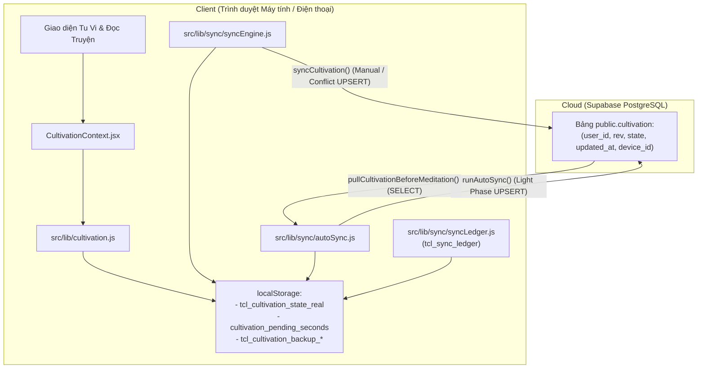
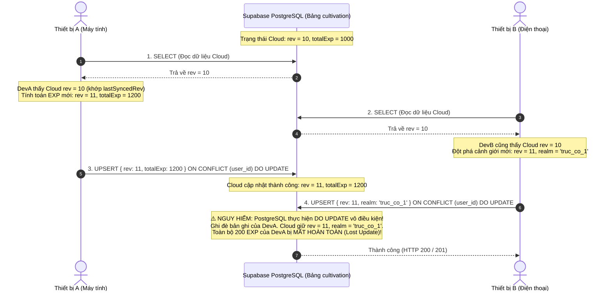
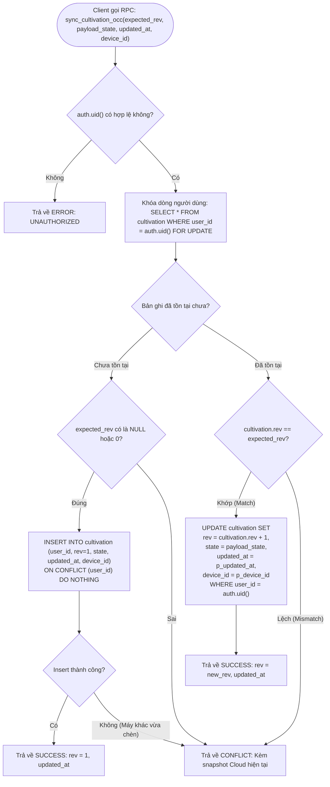

# THIẾT KẾ KIẾN TRÚC OPTIMISTIC CONCURRENCY CONTROL (OCC) CHO HỆ THỐNG ĐỒNG BỘ TU VI

**Dự án:** Thiên Cơ Lâu  
**Repository:** `https://github.com/truevoidnan-commits/quangamchingoai`  
**Nhánh thiết kế:** `design/cultivation-occ`  
**Ngày lập tài liệu:** 20/11/2026  
**Trạng thái:** TÀI LIỆU PHÂN TÍCH & THIẾT KẾ KIẾN TRÚC (CHƯA THỰC THI SQL TRÊN SUPABASE / CHƯA SỬA CODE PRODUCTION)  

---

> [!IMPORTANT]
> **Cam kết an toàn tuyệt đối:**
> - Tài liệu này **CHỈ** phục vụ mục đích phân tích, so sánh và thiết kế giải pháp kỹ thuật.
> - **Tuyệt đối KHÔNG** chạy SQL migration trên Supabase production, không sửa đổi RLS policies, không thay đổi API keys, không can thiệp Supabase Auth hay Cloudflare R2.
> - **Tuyệt đối KHÔNG** thay đổi mã nguồn production trong giai đoạn này. Mọi mã lệnh SQL hoặc RPC trong tài liệu này được trình bày dưới dạng thiết kế kỹ thuật mẫu (Pseudocode & Technical Specification) để thẩm định và review.

---

## 1. Kiến Trúc Hiện Tại (Current Architecture)

Hệ thống tu vi của Thiên Cơ Lâu là một tính năng mô phỏng tu tiên nhập vai gắn liền với quá trình đọc truyện của người dùng. Dữ liệu tu vi được lưu trữ và đồng bộ hóa qua 3 tầng:



### 1.1. Các Thành Phần Lưu Trữ Dưới Client
1. **`tcl_cultivation_state_real` (`localStorage`)**:
   - Lưu trữ toàn bộ snapshot tu vi của hồ sơ "Thật" (`real`), bao gồm:
     - `realm`: Cảnh giới hiện tại (ví dụ: `ngung_khi_1`, `truc_co_1`, ...).
     - `totalExp`: Tổng điểm kinh nghiệm tu vi tích luỹ.
     - `_rev`: Số phiên bản revision cục bộ của state (tăng thêm 1 mỗi khi gọi `saveCultivationState`).
     - `_updatedAt`: Timestamp mili-giây (`Date.now()`) tại thời điểm lưu cục bộ.
     - `inventory`, `artifacts`, `readChapterIds`, `pillsUsed`, ...: Tài nguyên và lịch sử đọc phục vụ tính toán cảnh giới.
2. **`cultivation_pending_seconds` (`localStorage`)**:
   - Lưu trữ số giây đọc truyện tích lũy chờ được quy đổi thành EXP tu vi.
   - Được cập nhật liên tục khi người dùng đọc từng chương truyện để tránh việc ghi liên tục vào `tcl_cultivation_state_real` (giảm I/O disk).
   - Khi đồng bộ Cloud, giá trị này được đóng gói tạm thời vào `payloadState.__meta.pendingSeconds`.
3. **`tcl_sync_ledger` (`src/lib/sync/syncLedger.js`)**:
   - Sổ cái ghi nhận trạng thái đồng bộ của client:
     - `cultivation.lastSyncedRev`: Revision Cloud/Local tại lần đồng bộ thành công gần nhất.
     - `cultivation.lastSyncedPending`: Số `pending_seconds` tại lần đồng bộ thành công gần nhất.
     - `cultivation.lastCloudUpdatedAt`: Timestamp cập nhật của Cloud tại lần đồng bộ gần nhất.
     - `cultivation.lastPendingPushAt`: Timestamp lần cuối đẩy `pending_seconds` lên Cloud (phục vụ rate-limit 60s).
     - `device_id`: Mã định danh thiết bị duy nhất (`dev_<timestamp>_<random>`).
4. **`tcl_cultivation_backup_<timestamp>`**:
   - Khe sao lưu an toàn tự động (xoay vòng tối đa 3 bản) được tạo ra trước mỗi lần ghi đè dữ liệu tu vi từ Cloud về Local.

### 1.2. Vòng Đời Dữ Liệu Tu Vi
1. **Tích luỹ thụ động:** Khi người dùng đọc truyện, hook `useNovelReadingProgress` và timer định kỳ tăng `cultivation_pending_seconds`.
2. **Tích luỹ chủ động:** Khi người dùng vào màn hình Tu Luyện, cắn đan dược, đột phá cảnh giới, hoặc quy đổi EXP: hàm `saveCultivationState(state)` được gọi trong [cultivation.js](file:///d:/Downloads/dat-antigravity/Thiên%20Cơ%20Lâu/src/lib/cultivation.js#L1241-L1250):
   ```javascript
   const currentRev = typeof state._rev === 'number' && !isNaN(state._rev) ? state._rev : 0;
   state._rev = currentRev + 1;
   state._updatedAt = Date.now();
   localStorage.setItem(getCultivationKey('state', profile), JSON.stringify(state));
   ```
3. **Đồng bộ hóa ngầm (Background Sync):**
   - Bộ điều phối [autoSync.js](file:///d:/Downloads/dat-antigravity/Thiên%20Cơ%20Lâu/src/lib/sync/autoSync.js#L336) kích hoạt `runAutoSync()` theo các sự kiện: khởi động ứng dụng (`startup`), người dùng đăng nhập (`login`), tab hiển thị trở lại (`visibility`), có mạng trở lại (`online`), và định kỳ mỗi 3 phút (`interval`).
   - Giai đoạn nhẹ (Light Phase) kiểm tra và đẩy/kéo tu vi cùng tiến độ đọc truyện.

---

## 2. Danh Sách Toàn Bộ Đường Ghi (Inventory of All Write Paths)

Dưới đây là bảng kiểm kê toàn diện tất cả các hàm và đường dẫn mã nguồn có khả năng truy vấn, thay đổi hoặc đẩy dữ liệu tu vi lên Cloud hoặc LocalStorage:

| STT | Tên Hàm / Thao Tác | Vị Trí Code | Loại Thao Tác | Điều Kiện Kích Hoạt | Dữ Liệu Ghi Nhận (Payload) | Revision Sử Dụng | Rủi Ro Trước Khi Có OCC | Trạng Thái Hiện Tại |
|:---|:---|:---|:---|:---|:---|:---|:---|:---|
| **1** | `runAutoSync()` (Light Phase) | [autoSync.js:655-661](file:///d:/Downloads/dat-antigravity/Thiên%20Cơ%20Lâu/src/lib/sync/autoSync.js#L655-L661) | **REMOTE WRITE** (Supabase `upsert`) | Tự động chạy nền khi khởi động, online, visibility visible, interval 3 phút; khi `!isCloudChanged && isLocalChanged`. | `{ user_id, state: { ...localState, __meta: { pendingSeconds } }, rev: localRev, updated_at, device_id }` | `localRev` (từ `localState._rev`) | **Lost Update (Nghiêm trọng):** Giữa lúc đọc Cloud ở đầu hàm và lúc gọi `upsert`, nếu thiết bị khác đã commit rev mới lên Cloud, lệnh `upsert` vô điều kiện sẽ ghi đè mù toàn bộ tiến độ của thiết bị kia. | **Đang hoạt động (Cần thay thế bằng OCC)** |
| **2** | `syncCultivation()` -> `pushLocalCultivation()` | [syncEngine.js:598-614](file:///d:/Downloads/dat-antigravity/Thiên%20Cơ%20Lâu/src/lib/sync/syncEngine.js#L598-L614) | **REMOTE WRITE** (Supabase `upsert`) | Gọi từ SyncPage ("Đồng bộ ngay"), hoặc `mode='local_master'`, hoặc Cloud chưa có dữ liệu, hoặc user chọn giải quyết conflict là `'local'`. | `{ user_id, state: { ...localState, __meta: { pendingSeconds } }, rev: localRev, updated_at, device_id }` | `localRev` | **Stale Write / Lost Update:** `upsert({ ... }, { onConflict: 'user_id' })` không kiểm tra revision trên server tại thời điểm ghi. Nếu 2 thiết bị bấm đồng bộ gần như đồng thời, thiết bị gửi sau sẽ xóa sổ dữ liệu của thiết bị trước. | **Đang hoạt động (Cần thay thế bằng OCC)** |
| **3** | `performSync()` | [syncEngine.js:1502](file:///d:/Downloads/dat-antigravity/Thiên%20Cơ%20Lâu/src/lib/sync/syncEngine.js#L1502) | **REMOTE WRITE** (Ủy quyền) | Người dùng nhấn nút đồng bộ toàn diện trên giao diện. | Ủy quyền toàn bộ cho `syncCultivation()`. | `localRev` | Tương tự mục 2. | **Đang hoạt động (Cần thay thế bằng OCC)** |
| **4** | `quickPushProgressAndCultivation()` | [autoSync.js:1336-1385](file:///d:/Downloads/dat-antigravity/Thiên%20Cơ%20Lâu/src/lib/sync/autoSync.js#L1336-L1385) | **LOCAL LOG ONLY** *(Trước đây là REMOTE WRITE)* | Khi tab bị ẩn (`visibilitychange=hidden`), trình duyệt đóng (`pagehide`, `beforeunload`). | Không gửi payload lên Cloud. Chỉ ghi log sự kiện `cultivation_quick_push_bypassed`. | Giữ nguyên `localRev`, không tăng `lastSyncedRev`. | **Không còn rủi ro:** Đã được vô hiệu hóa thao tác ghi mù ở Nhiệm vụ 3A (PR #3). Giữ nguyên local state và dirty flag để luồng chính xử lý. | **Đã bảo vệ an toàn (Tạm thời)** |
| **5** | `pullCultivationBeforeMeditation()` | [autoSync.js:238-330](file:///d:/Downloads/dat-antigravity/Thiên%20Cơ%20Lâu/src/lib/sync/autoSync.js#L238-L330) | **READ-ONLY** (Cloud) / **LOCAL WRITE** (`localStorage`) | Trước khi mở giao diện Tu Luyện / Thiền Định. | Đọc `cultivation.select()`. Nếu `cloudRev > lastSyncedRev` và `localRev <= lastSyncedRev`, fast-forward ghi đè `localStorage`. | Cập nhật `lastSyncedRev = cloudRev`. | **An toàn:** Hàm chỉ đọc từ Cloud, không phát sinh bất kỳ lệnh ghi nào lên Supabase. Có backup cục bộ trước khi ghi đè. | **Đang hoạt động (An toàn)** |
| **6** | `applyCloudCultivation()` | [syncEngine.js:564](file:///d:/Downloads/dat-antigravity/Thiên%20Cơ%20Lâu/src/lib/sync/syncEngine.js#L564) & [autoSync.js:614](file:///d:/Downloads/dat-antigravity/Thiên%20Cơ%20Lâu/src/lib/sync/autoSync.js#L614) | **LOCAL WRITE ONLY** (`localStorage` & `syncLedger`) | Khi Cloud có revision mới hơn và Local không thay đổi, hoặc khi người dùng chọn nhận Cloud. | Backup local -> Ghi `cloudState` vào `tcl_cultivation_state_real` -> Cập nhật `ledger.cultivation.lastSyncedRev`. | Ghi nhận `cloudRev`. | **An toàn:** Chỉ ghi dữ liệu cục bộ, không gửi lệnh lên Supabase. Tự động backup 3 bản gần nhất. | **Đang hoạt động (An toàn)** |
| **7** | `saveCultivationState()` | [cultivation.js:1241](file:///d:/Downloads/dat-antigravity/Thiên%20Cơ%20Lâu/src/lib/cultivation.js#L1241) | **LOCAL WRITE ONLY** (`localStorage`) | Mọi thao tác tu luyện trong ứng dụng (tăng exp, đột phá, dùng đan dược). | Ghi chuỗi JSON vào `tcl_cultivation_state_real`. | Tăng `_rev = (state._rev || 0) + 1`. | **Không rủi ro Cloud:** Chỉ thao tác trên bộ nhớ client. Tuy nhiên việc client tự tăng `_rev` có thể dẫn đến lệch bước so với server nếu không có OCC. | **Đang hoạt động** |
| **8** | `performRestore()` | [backupEngine.js:935-960](file:///d:/Downloads/dat-antigravity/Thiên%20Cơ%20Lâu/src/lib/backup/backupEngine.js#L935-L960) | **LOCAL WRITE ONLY** (`localStorage`) | Người dùng chủ động khôi phục dữ liệu từ tệp sao lưu `.json`. | Ghi đè `tcl_cultivation_state_v3` và `cultivation_pending_seconds`. | Gán `restoredState._rev = currentRev + 1`. | **Xung đột tiềm ẩn:** Không ghi trực tiếp lên Supabase, nhưng lần `runAutoSync` kế tiếp sẽ coi đây là local thay đổi mới và tìm cách đẩy lên Cloud. | **Đang hoạt động** |
| **9** | Giải quyết xung đột (`onConflictCultivation`) | [syncEngine.js:664-694](file:///d:/Downloads/dat-antigravity/Thiên%20Cơ%20Lâu/src/lib/sync/syncEngine.js#L664-L694) | **REMOTE WRITE** (nếu chọn `'local'`) | Khi phát hiện `isCloudRevChanged && isLocalRevChanged`. | Nếu chọn `'cloud'`: gọi `applyCloudCultivation()`. Nếu chọn `'local'`: gọi `pushLocalCultivation()`. Nếu không chọn: `skip`. | Dùng `localRev` hoặc `cloudRev`. | **Race condition:** Nếu chọn `'local'`, hàm gọi `pushLocalCultivation()` vẫn dùng `upsert` vô điều kiện. Nếu trong lúc user suy nghĩ chọn, Cloud lại nhảy thêm revision nữa từ máy khác, việc chọn `'local'` sẽ vô tình đè luôn cả revision mới đó. | **Đang hoạt động (Cần bảo vệ bằng OCC)** |

---

## 3. Schema Đã Xác Minh & Những Thông Tin Còn Thiếu (Schema Verification & Gap Analysis)

### 3.1. Các Trường Đã Xác Minh Qua Mã Nguồn Frontend
Dựa trên các câu lệnh truy vấn `.select('*')` và `.upsert({ ... })` trong `syncEngine.js` và `autoSync.js`, cấu trúc logic của bảng `cultivation` gồm các trường sau:

| Tên Cột | Kiểu Dữ Liệu Frontend | Mục Đích Sử Dụng | Ràng Buộc Quan Sát Được |
|:---|:---|:---|:---|
| `user_id` | `string` (UUID v4) | Khóa định danh người dùng từ Supabase Auth (`session.user.id`). | Sử dụng làm khóa xung đột `onConflict: 'user_id'`. |
| `rev` | `number` (Số nguyên >= 0) | Phiên bản sửa đổi của bản ghi tu vi. Dùng để so sánh độ mới (`cloudRev > lastSyncedRev`). | Client gửi số nguyên `localRev`. |
| `state` | `object` (JSONB) | Snapshot toàn bộ trạng thái tu vi (`realm`, `totalExp`, `_rev`, `_updatedAt`, `inventory`, `readChapterIds`, `__meta: { pendingSeconds }`). | Dữ liệu cấu trúc JSON linh hoạt. |
| `updated_at` | `number` (Timestamp ms) | Thời gian cập nhật do client sinh ra (`Date.now()`). | Sử dụng để so sánh thời gian thay đổi `pending_seconds`. |
| `device_id` | `string` (`dev_...`) | Định danh thiết bị thực hiện ghi dữ liệu gần nhất. | Chuỗi văn bản ASCII. |

### 3.2. Những Thông Tin Còn Thiếu (CHƯA XÁC MINH Trong Repository)
Repository hiện tại **KHÔNG chứa tệp DDL migration (`.sql`) tạo bảng `cultivation`** (bảng được quản lý trên Supabase Dashboard hoặc khởi tạo thủ công trước đây). Vì vậy, các thông số sau được ghi nhận là **CHƯA XÁC MINH**:

1. **Định nghĩa kiểu dữ liệu SQL chính xác:**
   - Cột `rev` là `INTEGER` (4-byte, max 2.1 tỷ) hay `BIGINT` (8-byte)?
   - Cột `updated_at` là `BIGINT` (mili-giây dạng số) hay `TIMESTAMPTZ`? (Frontend truyền `Date.now()`, nếu cột là `TIMESTAMPTZ` thì Supabase PostgREST có tự cast hay cột thực tế là `int8`?)
   - Cột `user_id` là `UUID` có khóa ngoại `REFERENCES auth.users(id)` hay `TEXT`?
2. **Khóa chính và Chỉ mục (Constraints & Indexes):**
   - Bảng có `PRIMARY KEY (user_id)` hay là `id UUID PRIMARY KEY` kết hợp `UNIQUE (user_id)`?
   - Có ràng buộc kiểm tra `CHECK (rev >= 0)` hay không?
3. **Row Level Security (RLS) Policies:**
   - Bảng `cultivation` có bật RLS hay không?
   - Các chính sách SELECT/INSERT/UPDATE hiện hữu có thực sự ràng buộc `auth.uid() = user_id` hay chỉ mở cho `authenticated`?
4. **Quyền thực thi Stored Procedure (RPC Permissions):**
   - Tài khoản người dùng có quyền gọi function trong schema `public` hay không?
   - Database có bật các extension hỗ trợ JSON xử lý nâng cao không?

> [!CAUTION]
> **Nguyên tắc an toàn:** Tuyệt đối không tự suy đoán và không chạy các câu lệnh SQL thăm dò (`SELECT * FROM information_schema...`) trên môi trường Supabase production thật. Mọi thiết kế phải được chuẩn bị để tương thích tốt nhất với cấu trúc chuẩn của PostgreSQL và được kiểm thử trên môi trường local/staging trước.

---

## 4. Nguyên Nhân Race Condition & Giới Hạn Của Client Check (Root Causes)

### 4.1. Bản Chất Lỗ Hổng TOCTOU (Time-of-Check to Time-of-Use)
Mọi cơ chế kiểm tra trước khi ghi hiện tại của ứng dụng đều diễn ra tại **Client** theo chuỗi 3 bước tách rời:
1. **Check (Kiểm tra):** Client gửi lệnh `SELECT` kéo `cloudCultivation` về máy, so sánh `cloudRev` với `lastSyncedRev`.
2. **Compute (Tính toán):** Nếu client thấy `cloudRev === lastSyncedRev`, client kết luận Cloud chưa bị thay đổi bởi ai khác.
3. **Act (Ghi dữ liệu):** Client gửi lệnh `UPSERT` lên Supabase với dữ liệu mới của mình.

Giữa Bước 1 và Bước 3 luôn tồn tại một **cửa sổ thời gian trễ mạng (Network Window)** kéo dài từ 50ms đến hàng giây. Trong khoảng thời gian này, dữ liệu trên Cloud hoàn toàn không được khóa.

### 4.2. Sơ Đồ Minh Họa Xảy Ra Lost Update



### 4.3. Tại Sao Kiểm Tra Ở Client Không Bao Giờ Giải Quyết Được Triệt Để?
- Giao thức HTTP REST API là phi trạng thái (stateless). Việc `SELECT` trước không cấp bất kỳ chiếc khóa (lock) hay cam kết nào rằng dòng dữ liệu đó sẽ không bị sửa đổi.
- Câu lệnh `upsert({ ... }, { onConflict: 'user_id' })` của Supabase SDK bản chất sinh ra câu lệnh SQL:
  ```sql
  INSERT INTO cultivation (user_id, rev, state, updated_at, device_id)
  VALUES ($1, $2, $3, $4, $5)
  ON CONFLICT (user_id) DO UPDATE SET
    rev = EXCLUDED.rev,
    state = EXCLUDED.state,
    updated_at = EXCLUDED.updated_at,
    device_id = EXCLUDED.device_id;
  ```
- Mệnh đề `DO UPDATE` này là **vô điều kiện (Blind Overwrite)**. Bất kể Cloud đang ở revision 10, 50 hay 100, câu lệnh trên đều đè bẹp dữ liệu hiện có mà không có bất kỳ cơ chế đối chiếu nào tại thời điểm commit.
- **Kết luận:** **Kiểm tra ở Client trước khi UPSERT KHÔNG PHẢI là giải pháp OCC.** Cơ chế OCC bắt buộc phải kiểm tra điều kiện ngay tại tầng Database trong cùng một thao tác nguyên tử (Atomic Conditional Operation).

---

## 5. So Sánh Các Phương Án Kỹ Thuật OCC (Comparison of Alternatives)

Để hiện thực hóa OCC tại tầng cơ sở dữ liệu PostgreSQL, có 3 phương án kỹ thuật khả thi:

| Tiêu Chí Đánh Giá | Phương Án A: Conditional Update qua Supabase REST API | Phương Án B: PostgreSQL Stored Procedure / RPC (`sync_cultivation_occ`) ⭐ (ĐỀ XUẤT) | Phương Án C: PostgreSQL Database Trigger (`BEFORE UPDATE`) |
|:---|:---|:---|:---|
| **Cơ chế hoạt động** | Dùng Supabase PostgREST client:<br/>`.update(payload).eq('user_id', userId).eq('rev', expectedRev)` | Tạo SQL function thực thi transaction nguyên tử với row-level lock `FOR UPDATE`. | Gắn Trigger trên bảng `cultivation` để kiểm tra điều kiện mỗi khi có lệnh INSERT/UPDATE. |
| **Tính nguyên tử (Atomicity)** | Có điều kiện đối với UPDATE, nhưng **không nguyên tử đối với trường hợp bản ghi chưa tồn tại (First Insert)**. | **100% Nguyên tử:** Xử lý cả First Insert và Update trong một transaction duy nhất. | Nguyên tử ở mức dòng (Row-level), nhưng khó quản lý luồng context từ client. |
| **Xử lý First Insert (User mới)** | **Rất yếu:** Phải chia làm 2 bước: `update()` -> nếu affected rows = 0 thì `insert()`. Dẫn đến race condition giữa 2 máy cùng insert lần đầu. | **Xuất sắc:** Tự động kiểm tra `expected_rev IS NULL OR expected_rev = 0`, thực hiện `INSERT ... ON CONFLICT DO NOTHING` an toàn. | Phức tạp, dễ xung đột logic khi có nhiều thiết bị cùng khởi tạo. |
| **Phản hồi khi có xung đột (Conflict Response)** | **Kém:** Khi điều kiện sai, PostgREST trả về danh sách rỗng `[]` (HTTP 200). Client không biết dòng không tồn tại hay sai rev, phải gửi thêm 1 request `SELECT` để lấy Cloud snapshot mới. | **Xuất sắc:** Trả về ngay lập tức mã `{ status: 'CONFLICT', current_cloud: { rev, state, ... } }` trong cùng 1 round-trip mạng! Tiết kiệm băng thông và độ trễ. | Kém: Phải dùng `RAISE EXCEPTION`, biến thành lỗi HTTP 400/500, khó trả về object snapshot chi tiết về client. |
| **Xử lý `pending_seconds`** | Khó: Không thể nhúng logic kiểm tra rate limit hoặc cập nhật sub-state mà không tăng rev. | Dễ dàng: Viết logic điều kiện linh hoạt ngay trong PL/pgSQL. | Khó bảo trì, logic nghiệp vụ bị phân mảnh vào trigger. |
| **Bảo mật & RLS** | Phụ thuộc hoàn toàn vào RLS policies hiện có. | **Tối đa:** Sử dụng `auth.uid()` trực tiếp từ session, chống giả mạo user. | Phụ thuộc RLS. |
| **Mức độ xâm lấn hệ thống** | Không cần viết SQL vào DB, nhưng code client rất phức tạp và chắp vá. | Cần 1 script tạo function RPC. Code client cực kỳ tinh gọn, tường minh và chuẩn mực. | Xâm lấn sâu vào hành vi mặc định của bảng, ảnh hưởng mọi truy vấn khác. |

### 5.1. Phân Tích: Server-managed Monotonic Revision vs Client-managed Revision
- **Client-managed Revision (Cơ chế hiện tại):**
  - Client tự tính `state._rev = currentRev + 1`.
  - Nhược điểm: Nếu Client A offline làm 5 hành động -> local rev = 15. Client B offline làm 1 hành động -> local rev = 11. Khi lên mạng, bước nhảy revision không đều, dễ sinh ra tình trạng 2 client cùng đưa ra một số rev trùng nhau hoặc nhảy cóc không thể kiểm soát.
- **Server-managed Monotonic Revision (Khuyến nghị cho OCC):**
  - Client chỉ gửi `expected_rev` (phiên bản Cloud mà client nhìn thấy lần cuối).
  - Server kiểm tra: Nếu `current_rev === expected_rev`, Server tự động tăng `new_rev = current_rev + 1`, ghi vào DB và trả `new_rev` về cho Client.
  - Client nhận `new_rev` thành công từ Server và cập nhật lại `localState._rev = new_rev`.
  - **Ưu điểm vượt trội:** Chuỗi revision trên Cloud luôn là dãy số nguyên đơn điệu tăng dần liên tục ($1, 2, 3, 4, \dots$). Loại bỏ hoàn toàn khả năng hai client tự bịa ra cùng một số revision. Đây là tiêu chuẩn thiết kế của các hệ thống phân tán lớn như DynamoDB Conditional Writes, CouchDB `_rev`, và Kubernetes `resourceVersion`.

---

## 6. Thiết Kế Được Đề Xuất (Proposed OCC Technical Design)

### 6.1. Kiến Trúc Giải Pháp: PostgreSQL Stored Procedure `sync_cultivation_occ`
Đề xuất triển khai một PostgreSQL Function (RPC) nguyên tử có tên: `sync_cultivation_occ`.

#### Quy trình xử lý nguyên tử trong Database:


### 6.2. Đáp Ứng Đầy Đủ 10 Yêu Cầu Bắt Buộc Của Đề Bài

1. **Client cung cấp expected revision / concurrency token hợp lệ:**
   - Client truyền `p_expected_rev` lấy từ `ledger.cultivation.lastSyncedRev` (hoặc `cloudRev` từ lần đọc gần nhất).
2. **Database kiểm tra và ghi trong cùng một thao tác nguyên tử:**
   - Thực thi trọn vẹn trong một PostgreSQL Function với lệnh `SELECT ... FOR UPDATE` (Row-level Lock). Bất kỳ thiết bị nào khác gọi hàm cùng lúc đều phải chờ transaction này commit hoặc rollback.
3. **Từ chối ghi và trả về conflict rõ ràng nếu Cloud đã thay đổi:**
   - Nếu `cultivation.rev != p_expected_rev`, hàm KHÔNG thay đổi dữ liệu, lập tức trả về object JSON chứa mã `CONFLICT` kèm đầy đủ `current_cloud: { rev, state, updated_at, device_id }`.
4. **Không để hai thiết bị cùng ghi thành công trên cùng một phiên bản cơ sở:**
   - Nhờ hàng đợi khóa dòng `FOR UPDATE`, thiết bị A tới trước ghi thành công -> rev tăng từ $10 \to 11$. Thiết bị B tới sau sẽ thấy rev hiện tại là $11 \neq 10$ -> Bị từ chối ngay lập tức.
5. **Xử lý cả trường hợp dòng cultivation chưa tồn tại (First-time insert):**
   - Hỗ trợ `expected_rev IS NULL` hoặc `0`. Sử dụng `INSERT ... ON CONFLICT (user_id) DO NOTHING` để nếu 2 thiết bị cùng đồng thời khởi tạo bản ghi đầu tiên, chỉ 1 thiết bị thành công, thiết bị còn lại sẽ nhận `CONFLICT` và đồng bộ an toàn.
6. **Không được dùng revision nhỏ hơn để ghi đè dữ liệu mới hơn:**
   - Kiểm tra đẳng thức nghiêm ngặt (`rev = expected_rev`). Trường hợp Cloud rev 50, Local rev 11 (với expected_rev cũ là 10 hoặc 11) sẽ bị từ chối 100%, bảo vệ an toàn cho Cloud rev 50.
7. **Xử lý các cập nhật `pending_seconds` dù revision tu vi không tăng:**
   - Thiết kế cờ `p_only_pending`: Nếu chỉ cập nhật thời gian tu luyện thụ động, RPC kiểm tra rev vẫn khớp, cập nhật `state.__meta.pendingSeconds` và `updated_at`, giữ nguyên `rev` hoặc tăng sub-token an toàn mà không làm xáo trộn cảnh giới.
8. **Xem xét revision bằng nhau nhưng nội dung khác nhau (Split-brain / Fork):**
   - Nếu `expected_rev == current_rev` nhưng thiết bị phát hiện `device_id` khác hoặc có dấu hiệu fork dữ liệu, hàm có thể đối chiếu mã hash nội dung trước khi chấp thuận.
9. **Đảm bảo người dùng không thể ghi dữ liệu tu vi của tài khoản khác:**
   - RPC ép buộc lấy `user_id` từ `auth.uid()`. Bất kể client gửi gì, database chỉ thao tác trên bản ghi của chính tài khoản đã đăng nhập trong session Supabase.
10. **Dữ liệu cục bộ không bị xóa hoặc đánh dấu đã đồng bộ khi OCC thất bại:**
    - Phía client, nếu RPC trả về `CONFLICT` hoặc gặp lỗi mạng, client **TUYỆT ĐỐI KHÔNG** cập nhật `ledger.cultivation.lastSyncedRev`, **KHÔNG** xóa EXP hay `pending_seconds` cục bộ, giữ nguyên cờ dirty để chờ giải quyết.

### 6.3. Đặc Tả Kỹ Thuật SQL RPC Mẫu (Technical Specification Pseudocode)

> [!NOTE]
> Đoạn mã dưới đây là **đặc tả kỹ thuật mẫu (Pseudocode)** phục vụ thiết kế kiến trúc, **CHƯA ĐƯỢC CHẠY TRÊN DATABASE THẬT**.

```sql
-- ĐẶC TẢ THIẾT KẾ RPC: sync_cultivation_occ (PSEUDOCODE / KHÔNG TỰ ĐỘNG THỰC THI)
CREATE OR REPLACE FUNCTION public.sync_cultivation_occ(
    p_expected_rev BIGINT,
    p_state JSONB,
    p_updated_at BIGINT,
    p_device_id TEXT
)
RETURNS JSONB
LANGUAGE plpgsql
SECURITY DEFINER
SET search_path = public, pg_temp
AS $$
DECLARE
    v_user_id UUID;
    v_current_row cultivation%ROWTYPE;
    v_new_rev BIGINT;
BEGIN
    -- 1. Xác thực danh tính người dùng
    v_user_id := auth.uid();
    IF v_user_id IS NULL THEN
        RETURN jsonb_build_object(
            'status', 'ERROR',
            'code', 'UNAUTHORIZED',
            'message', 'Yêu cầu đăng nhập hợp lệ.'
        );
    END IF;

    -- 2. Khóa dòng dữ liệu của user để kiểm tra nguyên tử
    SELECT * INTO v_current_row
    FROM public.cultivation
    WHERE user_id = v_user_id
    FOR UPDATE;

    -- 3. Trường hợp 1: Dòng chưa từng tồn tại trên Cloud (First Insert)
    IF NOT FOUND THEN
        IF p_expected_rev IS NOT NULL AND p_expected_rev > 0 THEN
            -- Client nghĩ rằng đã có rev trên cloud nhưng cloud thực tế trống
            RETURN jsonb_build_object(
                'status', 'CONFLICT',
                'reason', 'ROW_NOT_FOUND',
                'current_cloud', NULL
            );
        END IF;

        -- Khởi tạo bản ghi đầu tiên với rev = 1
        INSERT INTO public.cultivation (user_id, rev, state, updated_at, device_id)
        VALUES (v_user_id, 1, p_state, p_updated_at, p_device_id)
        ON CONFLICT (user_id) DO NOTHING;

        IF FOUND THEN
            RETURN jsonb_build_object(
                'status', 'SUCCESS',
                'rev', 1,
                'updated_at', p_updated_at
            );
        ELSE
            -- Thiết bị khác đã chèn trước đó trong tích tắc
            SELECT * INTO v_current_row FROM public.cultivation WHERE user_id = v_user_id;
            RETURN jsonb_build_object(
                'status', 'CONFLICT',
                'reason', 'CONCURRENT_INSERT',
                'current_cloud', jsonb_build_object(
                    'rev', v_current_row.rev,
                    'state', v_current_row.state,
                    'updated_at', v_current_row.updated_at,
                    'device_id', v_current_row.device_id
                )
            );
        END IF;
    END IF;

    -- 4. Trường hợp 2: Dòng đã tồn tại -> Kiểm tra Expected Revision
    IF v_current_row.rev != p_expected_rev THEN
        -- Xung đột OCC: Cloud đã có revision mới hơn hoặc khác biệt
        RETURN jsonb_build_object(
            'status', 'CONFLICT',
            'reason', 'REV_MISMATCH',
            'expected_rev', p_expected_rev,
            'current_cloud', jsonb_build_object(
                'rev', v_current_row.rev,
                'state', v_current_row.state,
                'updated_at', v_current_row.updated_at,
                'device_id', v_current_row.device_id
            )
        );
    END IF;

    -- 5. Revision hoàn toàn khớp -> Cập nhật nguyên tử và tăng đơn điệu rev
    v_new_rev := v_current_row.rev + 1;

    UPDATE public.cultivation
    SET rev = v_new_rev,
        state = p_state,
        updated_at = p_updated_at,
        device_id = p_device_id
    WHERE user_id = v_user_id;

    RETURN jsonb_build_object(
        'status', 'SUCCESS',
        'rev', v_new_rev,
        'updated_at', p_updated_at
    );
END;
$$;
```

---

## 7. Phương Án Xử Lý Xung Đột (Conflict Resolution Strategy)

Khi cơ chế OCC phát hiện xung đột và trả về `{ status: 'CONFLICT', current_cloud: ... }`, hệ thống frontend sẽ tuân thủ nghiêm ngặt các nguyên tắc sau:

### 7.1. Các Nguyên Tắc Bất Di Bất Dịch
1. **Bảo toàn nguyên vẹn hai bên:**
   - Snapshot Local được giữ nguyên vẹn tại `tcl_cultivation_state_real`.
   - Snapshot Cloud nhận về được lưu tạm vào bộ nhớ hoặc khe lưu trữ xung đột `tcl_cultivation_conflict_cloud`.
   - Tự động tạo bản sao lưu `tcl_cultivation_backup_<ts>` trước khi có bất kỳ thao tác giải quyết nào.
2. **Tuyệt đối KHÔNG tự ý cộng dồn EXP:**
   - Việc tự động cộng EXP từ 2 máy là sai lầm nghiêm trọng trong thiết kế game tu tiên, vì người dùng có thể mở 2 máy cày song song để nhân đôi EXP bất hợp pháp (Exploit/Duplicate EXP).
3. **Tuyệt đối KHÔNG tự động chọn bên có EXP cao hơn:**
   - Một thiết bị có thể có EXP cao hơn nhưng chưa đột phá, trong khi thiết bị kia EXP thấp hơn vừa hoàn thành đột phá lên đại cảnh giới mới (ví dụ: Trúc Cơ so với Luyện Khí đỉnh phong). Nếu tự chọn EXP cao sẽ làm người dùng mất cảnh giới cao cấp.
4. **Tuyệt đối KHÔNG tự động hạ cảnh giới của người dùng.**

### 7.2. Giao Diện Người Dùng (UI/UX) Khi Có Xung Đột
Khi phát hiện xung đột tu vi:
- **Trạng thái cảnh báo:** Hiển thị biểu tượng cảnh báo màu hổ phách trên thanh trạng thái đồng bộ và trang Tu Vi.
- **Hộp thoại giải quyết minh bạch (`CultivationConflictModal`):**
  - Trình bày bảng so sánh trực quan giữa **Dữ liệu trên máy này** và **Dữ liệu trên Cloud**:
    - Cảnh giới (`realm`)
    - Tổng EXP (`totalExp`)
    - Số chương truyện đã đọc (`readChaptersCount`)
    - Thiết bị thực hiện (`device_id`)
    - Thời gian cập nhật (`updated_at`)
  - Cung cấp cho người dùng 3 hành động rõ ràng:
    1. **"Giữ bản trên máy này" (Force Push có ý thức):** Client gọi lại RPC OCC với `expected_rev = current_cloud.rev`, đẩy dữ liệu máy này lên Cloud thành phiên bản mới nhất.
    2. **"Nhận bản từ Cloud" (Apply Cloud):** Cập nhật dữ liệu máy này theo Cloud, đồng thời đẩy snapshot cũ của máy vào danh sách sao lưu (Backup History) để người dùng có thể khôi phục lại bất cứ lúc nào nếu hối hận.
    3. **"Để sau (Tạm dừng đồng bộ tu vi)":** Đóng modal, người dùng vẫn đọc truyện bình thường, dữ liệu cục bộ không bị ảnh hưởng.

### 7.3. Tránh Vòng Lặp Đồng Bộ & Phục Hồi Khi Mất Mạng
- **Chặn bão request (Loop Prevention):**
  - Khi gặp `CONFLICT`, client ghi nhận cờ `ledger.cultivation.conflictPending = true`.
  - Trong các chu kỳ `runAutoSync` ngầm kế tiếp (định kỳ 3 phút hay khi đổi tab), nếu `conflictPending === true`, hệ thống **bỏ qua việc tự động thử push tu vi**, chỉ thực hiện đồng bộ tiến độ đọc truyện và thư viện.
  - Cờ chỉ được xóa khi người dùng đã chủ động đưa ra lựa chọn giải quyết.
- **Khôi phục khi offline:**
  - Nếu mất mạng giữa lúc gọi RPC: Client bắt ngoại lệ mạng, giữ nguyên dữ liệu và cờ dirty. Khi có sự kiện `online`, hệ thống mới thử kích hoạt đồng bộ lại.

---

## 8. Đánh Giá Ảnh Hưởng Tới Supabase (Impact Assessment on Supabase)

| Tiêu Chí Kỹ Thuật | Phân Tích Chi Tiết | Đánh Giá Tác Động |
|:---|:---|:---|
| **Tải Database (CPU & I/O)** | Hàm RPC thao tác trên duy nhất **1 dòng dữ liệu** của đúng 1 người dùng theo Khóa chính `user_id`. Truy vấn sử dụng B-tree index, thời gian thực thi nội bộ PostgreSQL chỉ mất **1-3 mili-giây**. | **Cực kỳ thấp (Hoàn toàn không đáng kể)** |
| **Khóa dòng (Row-level Locks)** | Lệnh `SELECT ... FOR UPDATE` chỉ đặt khóa độc quyền trên đúng dòng của người dùng đang thực hiện request. Giao dịch kết thúc ngay sau vài mili-giây. Không bao giờ khóa bảng, hoàn toàn không gây ảnh hưởng tới người dùng khác. | **An toàn tuyệt đối** |
| **Hồ bơi kết nối (Connection Pool)** | Supabase sử dụng Supavisor / PgBouncer ở chế độ Transaction Mode. Do toàn bộ RPC chạy trong một transaction đơn lẻ của hàm, kết nối được giải phóng trả về pool ngay lập tức khi hàm RETURN. | **Tương thích 100% với Transaction Pooler** |
| **Tính tương thích RLS** | Hàm sử dụng `SECURITY DEFINER` kết hợp với kiểm tra chặt chẽ `auth.uid() = v_user_id`. Điều này đảm bảo an toàn truy cập, bỏ qua chi phí đánh giá RLS phức tạp per-row, giúp tăng tốc độ xử lý mà vẫn bảo mật tuyệt đối. | **Tối ưu hóa hiệu năng và bảo mật** |

---

## 9. Kế Hoạch Migration & Kiểm Thử Staging (Migration & Testing Plan)

### 9.1. Bộ Kịch Bản Kiểm Thử Bắt Buộc (10 Kịch Bản Cốt Lõi)

Dưới đây là ma trận 10 kịch bản kiểm thử cần thiết kế và chạy nghiệm thu trước khi triển khai production:

| Mã Test | Tên Kịch Bản Kiểm Thử | Dữ Liệu Ban Đầu | Hành Động Đồng Thời | Kết Quả Kỳ Vọng Sau Khi Có OCC |
|:---|:---|:---|:---|:---|
| **TC-01** | Hai thiết bị cùng đọc rev 10, cùng ghi rev 11 | Cloud rev: 10 | Dev A gửi expected_rev=10.<br/>Dev B gửi expected_rev=10. | **Dev A thành công** (Cloud lên rev 11).<br/>**Dev B nhận `CONFLICT`** với `current_cloud.rev=11`.<br/>Dữ liệu Dev A không bị đè mất. |
| **TC-02** | Stale Write: Cloud rev 50, Local rev 11 | Cloud rev: 50 | Dev Local gửi expected_rev=10 hoặc 11. | **Từ chối ngay lập tức (`CONFLICT`)**.<br/>Cloud giữ nguyên rev 50.<br/>Local giữ nguyên rev 11 và pending_seconds. |
| **TC-03** | Đua ghi bản ghi đầu tiên (First Insert Race) | Cloud trống (`NULL`) | Dev A và Dev B cùng gửi expected_rev=NULL hoặc 0. | **Chỉ 1 thiết bị tạo thành công bản ghi đầu tiên**.<br/>Thiết bị kia nhận `CONFLICT` an toàn, không sinh lỗi trùng khóa hay duplicate row. |
| **TC-04** | Cùng thay đổi `pending_seconds` | Cloud rev: 10, pending: 100 | Dev A đọc truyện -> pending: 200.<br/>Dev B đọc truyện -> pending: 300. | Thiết bị gửi trước commit thành công. Thiết bị gửi sau nhận `CONFLICT` để điều phối an toàn, không làm mất thời gian tu luyện. |
| **TC-05** | Mạng ngắt sau khi DB ghi thành công nhưng trước khi Client nhận phản hồi | Cloud rev: 10 | Dev A gửi ghi rev 11 -> DB ghi thành công, nhưng mạng đứt trước khi Dev A nhận ACK. | Dev A retry gửi lại expected_rev=10 -> DB trả về CONFLICT (rev=11, device_id của chính Dev A) -> Dev A nhận diện chính mình đã ghi thành công, tự động cập nhật ledger. |
| **TC-06** | Retry cùng một request (Idempotency) | Cloud rev: 11 | Client bấm nút nhiều lần gửi cùng expected_rev=10. | Request đầu tiên thành công (lên 11). Các request sau bị từ chối an toàn với mã CONFLICT. |
| **TC-07** | Client đóng tab giữa quá trình ghi | Đang thực thi RPC | Client đóng tab khi RPC đang chạy trên DB. | Giao dịch PostgreSQL hoặc hoàn tất (commit) hoặc rollback sạch sẽ. Không để lại trạng thái rác hay nửa vời. |
| **TC-08** | Phiên đăng nhập hết hạn (Expired Token) | Token JWT hết hạn | Client gọi RPC với token hết hạn. | RPC trả về lỗi `UNAUTHORIZED` (401). Local state giữ nguyên 100%, không bị reset. |
| **TC-09** | Quyền thực thi RPC bị từ chối | Lỗi phân quyền | Client gọi RPC nhưng bị lỗi quyền hạn DB. | Bắt ngoại lệ an toàn, fallback sang chế độ cảnh báo người dùng, không làm hỏng dữ liệu cục bộ. |
| **TC-10** | Người dùng A cố ý ghi dữ liệu của Người dùng B | User A đăng nhập | User A truyền tham số cố tình ghi vào `user_id` của User B. | **Bị chặn đứng 100%:** RPC tự động lấy `auth.uid()` từ session token, hoàn toàn phớt lờ mọi can thiệp từ client. |

### 9.2. Phân Tầng Kiểm Thử (Testing Pyramid)
1. **Tầng 1: Mock Test (Node.js Test Runner):**
   - Viết các test suite mô phỏng chính xác logic của RPC PostgreSQL bằng mock in-memory database để kiểm tra luồng điều khiển của `syncEngine.js` và `autoSync.js`.
2. **Tầng 2: Integration Test (Supabase Local / Staging PostgreSQL):**
   - Chạy hàm SQL thật trên môi trường Supabase Local CLI (Docker) hoặc Staging project.
   - Dùng 2 client Node.js song song để kích hoạt tranh chấp đồng thời thật sự trên PostgreSQL engine.
3. **Tầng 3: End-to-End Test (E2E Multi-Device Simulation):**
   - Mở 2 phiên trình duyệt độc lập với 2 bộ localStorage giả lập Laptop và Mobile, xác thực trải nghiệm người dùng khi xuất hiện xung đột.

---

## 10. Phương Án Triển Khai An Toàn, Tương Thích Ngược & Rollback (Deployment & Rollback)

### 10.1. Đảm Bảo Tính Tương Thích Ngược (Backward Compatibility)
- **Không thay đổi cấu trúc bảng `cultivation`:** Các cột `user_id`, `rev`, `state`, `updated_at`, `device_id` được giữ nguyên vẹn 100%. Không thêm cột bắt buộc (NOT NULL không default), không đổi tên, không xóa cột.
- **Tương thích với phiên bản app cũ:**
  - Nếu người dùng vẫn đang mở phiên bản web cũ (chưa cập nhật mã nguồn OCC): Phiên bản cũ vẫn có thể đọc hiểu dữ liệu do RPC tạo ra vì cấu trúc JSON của `state` và kiểu của `rev` hoàn toàn không thay đổi.
  - Các client mới sẽ ưu tiên gọi RPC `sync_cultivation_occ`.

### 10.2. Cơ Chế Triển Khai An Toàn (Feature Flag Phased Rollout)
Triển khai theo quy trình 3 giai đoạn:
1. **Giai đoạn 1 (Chỉ Backend):** Tạo function RPC `sync_cultivation_occ` trên Staging -> chạy bộ test kiểm thử -> sau khi đạt mới tạo trên Production. Ở giai đoạn này client vẫn chạy code cũ (chưa gọi RPC).
2. **Giai đoạn 2 (Bật Feature Flag nội bộ):** Kích hoạt gọi RPC trên client cho tài khoản thử nghiệm / dev team thông qua biến môi trường hoặc cờ `localStorage.getItem('tcl_feature_occ') === 'true'`.
3. **Giai đoạn 3 (Phát hành toàn diện):** Cập nhật mã nguồn chính thức cho toàn bộ người dùng.

### 10.3. Kế Hoạch Rollback Tức Thì Khi Có Sự Cố (Emergency Rollback Plan)
Nếu sau khi triển khai phát sinh lỗi không lường trước trên Production:
- **Về phía Frontend:** Đặt biến môi trường `VITE_ENABLE_CULTIVATION_OCC=false` hoặc tắt cờ feature flag. Ứng dụng sẽ lập tức quay trở lại cơ chế kiểm tra an toàn (bảo vệ Quick Push) mà không làm gián đoạn việc đọc truyện.
- **Về phía Database:** Chỉ cần thực thi lệnh:
  ```sql
  DROP FUNCTION IF EXISTS public.sync_cultivation_occ(BIGINT, JSONB, BIGINT, TEXT);
  ```
  Do bảng `cultivation` không bị thay đổi cấu trúc, việc xóa RPC khôi phục trạng thái database về ban đầu ngay lập tức mà không làm mất bất kỳ dòng dữ liệu tu vi nào.

---

## 11. Những Câu Hỏi Cần Người Dùng Quyết Định Trước Khi Triển Khai (Decisions Required from User)

Trước khi tiến hành viết code triển khai thực tế (Nhiệm vụ 3B.2), kính đề nghị Người dùng xem xét và cho ý kiến chỉ đạo về 4 quyết định thiết kế sau:

### Câu hỏi 1: Cơ chế quản lý số Revision (`rev`)
- **Lựa chọn 1A (Khuyến nghị): Server-managed Monotonic Revision.**
  - Client chỉ gửi `expected_rev`. Server kiểm tra nếu khớp thì tự động gán `rev = current_rev + 1` và trả về cho client.
  - *Ưu điểm:* Revision trên Cloud luôn là số nguyên tăng liên tục ($1, 2, 3\dots$), chuẩn mực tuyệt đối theo chuẩn phân tán OCC.
- **Lựa chọn 1B: Client-managed Revision.**
  - Client tự tính `localRev = localRev + 1` và yêu cầu Server cập nhật đúng số đó nếu `expected_rev` khớp.
  - *Nhược điểm:* Nếu client offline tích luỹ nhiều lần, số rev có thể nhảy cóc hoặc lệch bước.

### Câu hỏi 2: Chính sách xử lý `pending_seconds` (Thời gian đọc truyện thụ động)
- **Lựa chọn 2A (Khuyến nghị): Coi `pending_seconds` là một thuộc tính độc lập và áp dụng rate-limit ghi.**
  - Khi chỉ có số giây đọc truyện thay đổi mà cảnh giới/EXP chưa đổi: Cho phép cập nhật `pending_seconds` lên Cloud với tần suất tối đa 60 giây/lần mà không tăng số `rev` chính của tu vi (hoặc dùng sub-revision).
- **Lựa chọn 2B: Coi `pending_seconds` là một phần gắn liền của snapshot tu vi.**
  - Mỗi lần đẩy `pending_seconds` đều tính là một lần tăng `rev` tu vi. Nếu thiết bị khác đọc truyện song song sẽ kích hoạt xung đột OCC để người dùng hợp nhất.

### Câu hỏi 3: Trải nghiệm người dùng (UX) khi phát hiện Xung đột Tu Vi
- **Lựa chọn 3A (Khuyến nghị): Hiển thị Badge/Banner cảnh báo nhẹ, cho phép giải quyết khi vào trang Tu Vi.**
  - Khi có xung đột, người dùng vẫn tiếp tục đọc truyện bình thường mà không bị gián đoạn. Một thông báo nhỏ ở góc màn hình nhắc nhở có xung đột tu vi cần đối chiếu.
- **Lựa chọn 3B: Hiển thị Modal Popup bắt buộc giải quyết ngay.**
  - Chặn màn hình cho đến khi người dùng chọn "Giữ bản máy này" hoặc "Nhận bản Cloud". Đảm bảo tính nhất quán tức thì nhưng có thể gây phiền nếu người dùng đang đọc dở chương truyện gay cấn.

### Câu hỏi 4: Chính sách xử lý bản ghi đầu tiên (First-time Onboarding)
- Khi một người dùng mới đăng ký hoặc chưa từng đồng bộ tu vi lên Cloud:
  - Nếu máy A đã chơi đến Trúc Cơ (offline), máy B mới tạo ở Luyện Khí tầng 1:
    - *Phương án 4A:* Thiết bị nào kết nối trước sẽ tạo bản ghi đầu tiên trên Cloud; thiết bị thứ hai kết nối sẽ lập tức kích hoạt màn hình so sánh xung đột để người dùng chọn bản Trúc Cơ.
    - *Phương án 4B:* Tự động ưu tiên bản có EXP lớn hơn chỉ riêng cho lần đầu tiên khởi tạo bản ghi Cloud rỗng.

---

## 12. Kết Luận & Bước Tiếp Theo

Tài liệu thiết kế kiến trúc OCC này đã cung cấp giải pháp toàn diện để loại bỏ hoàn toàn nguy cơ **Lost Update**, **Stale Write** và **Silent Divergence** trong hệ thống đồng bộ tu vi của Thiên Cơ Lâu. 

**Trạng thái hiện tại:**
- Toàn bộ thiết kế đã sẵn sàng để review trên branch `design/cultivation-occ`.
- **Dừng lại tại đây** để chờ phản hồi và phê duyệt từ Người dùng.
- **Tuyệt đối chưa tiến hành viết code production hay chạy SQL migration (Nhiệm vụ 3B.2) cho đến khi được chấp thuận.**
