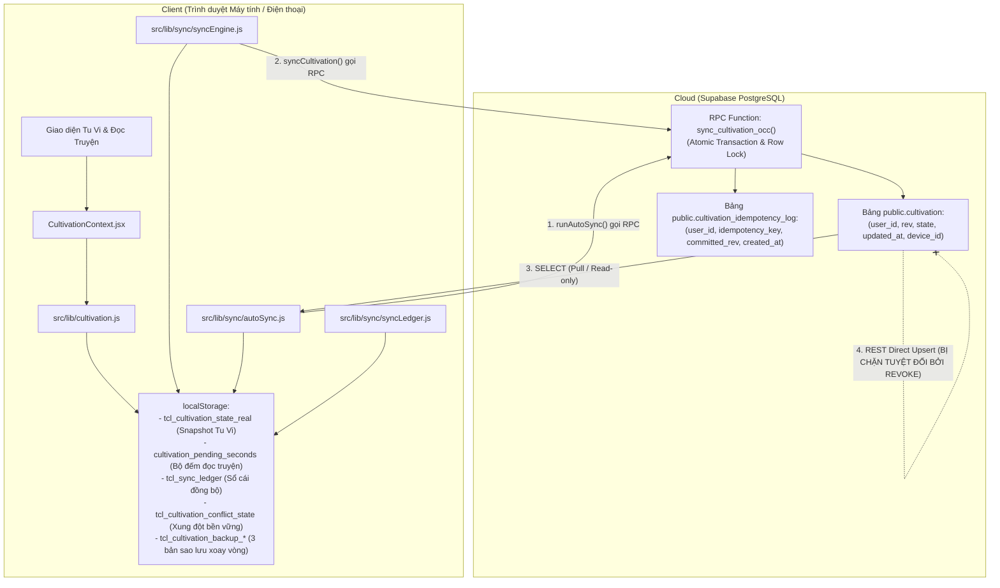
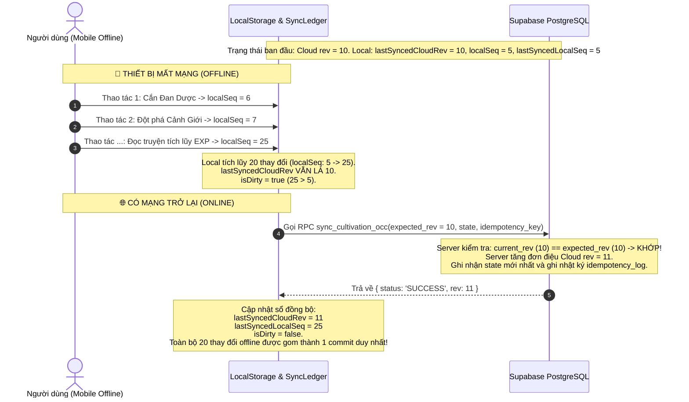
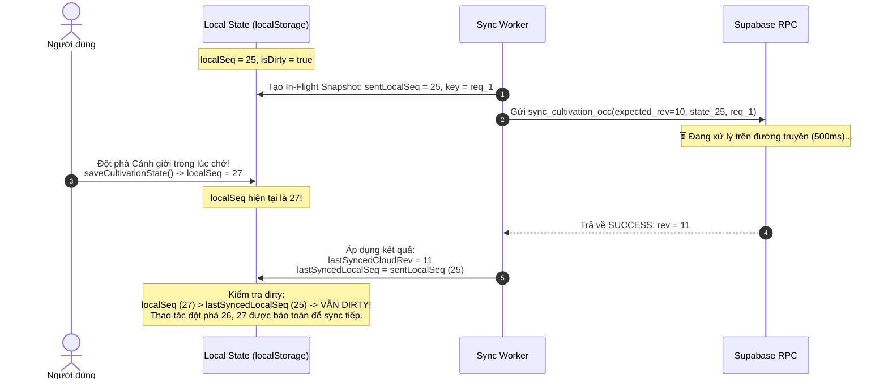
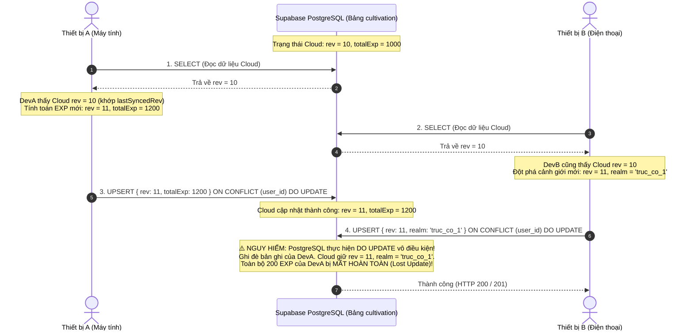
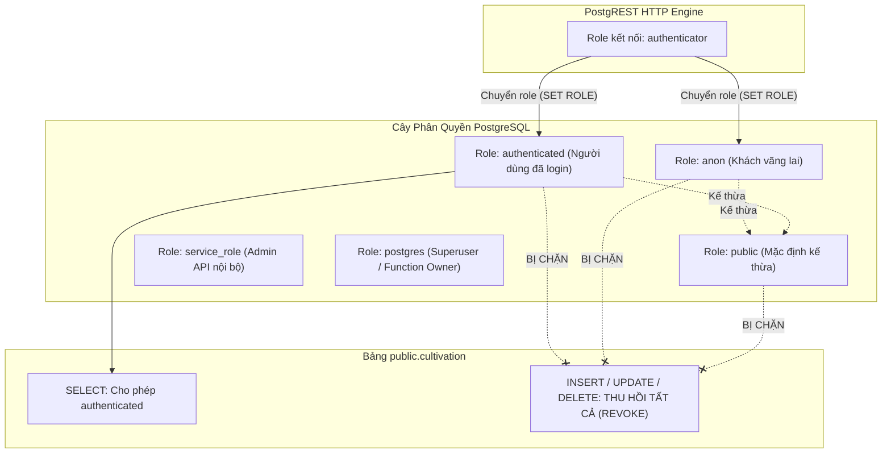
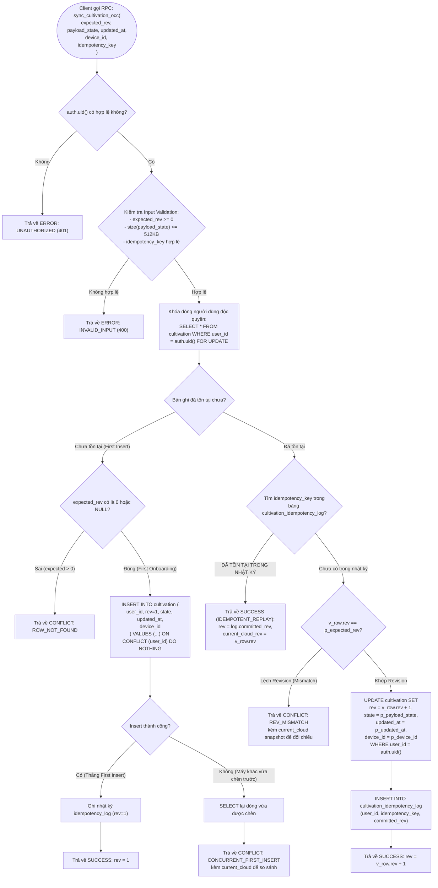

# THIẾT KẾ KIẾN TRÚC OPTIMISTIC CONCURRENCY CONTROL (OCC) CHO HỆ THỐNG ĐỒNG BỘ TU VI
## (Cập nhật hoàn thiện sau Review Vòng 2 — Nhiệm vụ 3B.1)

**Dự án:** Thiên Cơ Lâu  
**Repository:** `https://github.com/truevoidnan-commits/quangamchingoai`  
**Nhánh thiết kế:** `design/cultivation-occ`  
**Trạng thái Pull Request:** Draft PR #4 (`https://github.com/truevoidnan-commits/quangamchingoai/pull/4`)  
**Ngày cập nhật:** 20/11/2026  
**Mục đích:** TÀI LIỆU THIẾT KẾ KIẾN TRÚC CHÍNH THỨC (CHƯA THỰC THI SQL TRÊN SUPABASE PRODUCTION / CHƯA SỬA CODE PRODUCTION)  

---

> [!IMPORTANT]
> **Tuyên bố trạng thái an toàn & Phạm vi kỹ thuật:**
> - Hệ thống hiện tại **đang ở giai đoạn thiết kế kiến trúc**. Môi trường Production hiện tại **VẪN ĐANG ĐƯỢC BẢO VỆ TẠM THỜI** bởi cơ chế chặn ghi đè mù của Quick Push (đã hoàn thành ở Nhiệm vụ 3A / PR #3).
> - **Tuyệt đối KHÔNG tuyên bố OCC đã bảo vệ production** khi chưa hoàn tất cutover phân quyền và chưa vượt qua toàn bộ integration tests trên môi trường Staging.
> - **Tuyệt đối KHÔNG** chạy SQL migration trên Supabase production, không tự ý thay đổi quyền RLS/GRANT, không can thiệp API keys, Supabase Auth hoặc Cloudflare R2.
> - Mọi đoạn mã SQL/RPC trong tài liệu này là **đặc tả kỹ thuật mẫu (Technical Specification & Pseudocode)** phục vụ thẩm định và chuẩn bị cho Nhiệm vụ 3B.2.

---

## 1. Kiến Trúc Hiện Tại & Thiết Kế Tách Biệt Revision

### 1.1. Kiến Trúc Lưu Trữ 3 Tầng
Hệ thống tu vi của Thiên Cơ Lâu được lưu trữ và đồng bộ hóa qua 3 tầng dữ liệu:



### 1.2. Thiết Kế Tách Biệt Hoàn Toàn Giữa Local Revision và Cloud Revision (Quyết định 1A & Yêu cầu B)

Trong kiến trúc cũ, hàm `saveCultivationState()` tự tăng `state._rev = (state._rev || 0) + 1` mỗi khi lưu vào `localStorage`. Việc này khiến revision cục bộ bị phụ thuộc vào số lần người dùng thao tác trên máy đó thay vì phản ánh phiên bản dữ liệu trên Cloud, dẫn đến xung đột giả tạo hoặc nhảy cóc revision khi một máy offline nhiều ngày.

Để triển khai **Server-managed Monotonic Revision (Quyết định 1A)** một cách chuẩn mực, hệ thống thiết kế lại toàn bộ mối quan hệ giữa các biến trạng thái:

1. **`localSequenceNumber` (hoặc `localMutationSeq`)**:
   - Là bộ đếm số lần thay đổi dữ liệu cục bộ trong `localStorage`.
   - Mỗi lần gọi `saveCultivationState()` (tăng EXP, đột phá, cắn đan, quy đổi pending seconds), `localSequenceNumber` tăng thêm 1 đơn vị.
   - **Chỉ có ý nghĩa nội bộ tại máy khách**, tuyệt đối không dùng số này để gán vào `rev` của Cloud.
2. **`cloudRevision` (`cloud_rev`)**:
   - Là phiên bản chính thức, duy nhất và có thẩm quyền tối cao do PostgreSQL Server quản lý.
   - Tăng đơn điệu đúng 1 đơn vị ($1, 2, 3, 4\dots$) sau mỗi lần commit thành công qua RPC nguyên tử trên Supabase.
3. **`lastSyncedCloudRev`**:
   - Lưu trong `tcl_sync_ledger.cultivation.lastSyncedRev`.
   - Ghi nhận giá trị `cloudRevision` tại thời điểm thiết bị này đồng bộ thành công gần nhất với Cloud.
4. **`lastSyncedLocalSeq`**:
   - Lưu trong `tcl_sync_ledger.cultivation.lastSyncedLocalSeq`.
   - Ghi nhận giá trị `localSequenceNumber` tại thời điểm thiết bị này đồng bộ thành công gần nhất.
5. **`expectedRevision`**:
   - Concurrency Token mà Client gửi lên RPC trong mỗi request đồng bộ.
   - **Luôn luôn bằng `lastSyncedCloudRev`**. Đây là lời khẳng định của Client: *"Tôi muốn commit dữ liệu mới dựa trên nền tảng Cloud revision này"*.
6. **Trạng thái bẩn (`isDirty`) & Thay đổi chờ đồng bộ (`pendingChanges`)**:
   - Client được xác định là có dữ liệu mới chưa đẩy lên Cloud khi và chỉ khi:
     $$\text{isDirty} = (\text{localSequenceNumber} > \text{lastSyncedLocalSeq}) \lor (\text{localPending} \neq \text{lastSyncedPending})$$

### 1.3. Sơ Đồ Chuyển Đổi Trạng Thái Khi Thiết Bị Offline Tích Lũy Nhiều Thay Đổi



### 1.4. Xử Lý Biến Đổi Cục Bộ Trong Lúc Request RPC Đang Xử Lý (In-Flight Local Mutation)

Một lỗ hổng tinh vi trong các hệ thống phân tán là: **Người dùng tiếp tục thao tác trên máy trong lúc gói tin RPC đang bay trên đường truyền mạng.**

- **Tình huống xảy ra:**
  1. Lúc $T_0$: Client chuẩn bị gửi RPC với `localSequenceNumber = 25`, `expectedRevision = 10`.
  2. Gói tin mạng mất từ 500ms đến 2000ms để hoàn tất round-trip.
  3. Lúc $T_1$ (RPC đang chạy): Người dùng đọc xong 1 chương truyện, bấm "Đột phá Cảnh Giới". Hàm `saveCultivationState()` kích hoạt, làm tăng `localSequenceNumber` từ $25 \to 26$ và $26 \to 27$ trong `localStorage`.
  4. Lúc $T_2$: RPC phản hồi `SUCCESS` với `new_cloud_rev = 11`.
- **Rủi ro nếu thiết kế sai:** Nếu client vô tư cập nhật `lastSyncedLocalSeq = currentLocalSeq` (lúc này là 27), thì các thao tác 26 và 27 phát sinh ở $T_1$ sẽ bị đánh dấu nhầm là "đã đồng bộ", dẫn đến việc chúng không bao giờ được gửi lên Cloud (mất dữ liệu đột phá)!
- **Thiết kế giải pháp (Immutable In-Flight Snapshot):**
  1. Tại thời điểm bắt đầu dispatch request, client tạo một **bản chụp bất biến (In-Flight Snapshot)**:
     ```javascript
     const inFlightSnapshot = {
       sentLocalSeq: localSequenceNumber, // Giá trị cố định tại thời điểm gửi (ví dụ: 25)
       expectedRev: lastSyncedCloudRev,   // rev 10
       idempotencyKey: crypto.randomUUID(),
       payloadState: JSON.parse(JSON.stringify(localState)),
       sentPending: localPending
     };
     ```
  2. Khi nhận phản hồi `SUCCESS (new_rev: 11)`:
     - Client **CHỈ** cập nhật: `lastSyncedLocalSeq = inFlightSnapshot.sentLocalSeq` (tức là 25).
     - Cập nhật: `lastSyncedCloudRev = 11`.
  3. Đánh giá lại cờ dirty ngay lập tức:
     $$\text{isDirty} = (\text{localSequenceNumber } (27) > \text{lastSyncedLocalSeq } (25)) \implies \mathbf{TRUE}!$$
  4. **Kết quả:** Thao tác đột phá (seq 26, 27) diễn ra trong lúc gửi request vẫn tiếp tục được đánh dấu là "CHƯA ĐỒNG BỘ", và sẽ được tự động kích hoạt đẩy lên Cloud ở chu kỳ sync kế tiếp. Không một thao tác nào bị bỏ sót hay thất lạc!



---

## 2. Kiểm Kê Toàn Bộ Đường Ghi (Inventory of All Write Paths)

Bảng kiểm kê 9 đường ghi và thao tác truy cập dữ liệu tu vi trong mã nguồn Thiên Cơ Lâu:

| STT | Tên Hàm / Thao Tác | Vị Trí Code | Loại Thao Tác | Điều Kiện Kích Hoạt | Dữ Liệu Ghi Nhận (Payload) | Revision Sử Dụng | Rủi Ro Trước Khi Có OCC | Trạng Thái Hiện Tại |
|:---|:---|:---|:---|:---|:---|:---|:---|:---|
| **1** | `runAutoSync()` (Light Phase) | [autoSync.js:655-661](file:///d:/Downloads/dat-antigravity/Thiên%20Cơ%20Lâu/src/lib/sync/autoSync.js#L655-L661) | **REMOTE WRITE** (Supabase `upsert`) | Tự động chạy nền khi khởi động, online, visibility visible, interval 3 phút; khi `!isCloudChanged && isLocalChanged`. | `{ user_id, state: { ...localState, __meta: { pendingSeconds } }, rev: localRev, updated_at, device_id }` | `localRev` (từ `localState._rev`) | **Lost Update (Nghiêm trọng):** Giữa lúc đọc Cloud ở đầu hàm và lúc gọi `upsert`, nếu thiết bị khác đã commit rev mới lên Cloud, lệnh `upsert` vô điều kiện sẽ ghi đè mù toàn bộ tiến độ của thiết bị kia. | **Đang hoạt động (Bắt buộc thay bằng RPC)** |
| **2** | `syncCultivation()` -> `pushLocalCultivation()` | [syncEngine.js:598-614](file:///d:/Downloads/dat-antigravity/Thiên%20Cơ%20Lâu/src/lib/sync/syncEngine.js#L598-L614) | **REMOTE WRITE** (Supabase `upsert`) | Gọi từ SyncPage ("Đồng bộ ngay"), hoặc `mode='local_master'`, hoặc Cloud chưa có dữ liệu, hoặc user chọn giải quyết conflict là `'local'`. | `{ user_id, state: { ...localState, __meta: { pendingSeconds } }, rev: localRev, updated_at, device_id }` | `localRev` | **Stale Write / Lost Update:** `upsert({ ... }, { onConflict: 'user_id' })` không kiểm tra revision trên server tại thời điểm ghi. Nếu 2 thiết bị bấm đồng bộ gần như đồng thời, thiết bị gửi sau sẽ xóa sổ dữ liệu của thiết bị trước. | **Đang hoạt động (Bắt buộc thay bằng RPC)** |
| **3** | `performSync()` | [syncEngine.js:1502](file:///d:/Downloads/dat-antigravity/Thiên%20Cơ%20Lâu/src/lib/sync/syncEngine.js#L1502) | **REMOTE WRITE** (Ủy quyền) | Người dùng nhấn nút đồng bộ toàn diện trên giao diện. | Ủy quyền toàn bộ cho `syncCultivation()`. | `localRev` | Tương tự mục 2. | **Đang hoạt động (Bắt buộc thay bằng RPC)** |
| **4** | `quickPushProgressAndCultivation()` | [autoSync.js:1336-1385](file:///d:/Downloads/dat-antigravity/Thiên%20Cơ%20Lâu/src/lib/sync/autoSync.js#L1336-L1385) | **LOCAL LOG ONLY** *(Trước đây là REMOTE WRITE)* | Khi tab bị ẩn (`visibilitychange=hidden`), trình duyệt đóng (`pagehide`, `beforeunload`). | Không gửi payload lên Cloud. Chỉ ghi log sự kiện `cultivation_quick_push_bypassed`. | Giữ nguyên `localRev`, không tăng `lastSyncedRev`. | **Đã bảo vệ an toàn ở Nhiệm vụ 3A (PR #3):** Không còn rủi ro ghi đè mù Cloud khi đóng tab/ẩn trình duyệt. Giữ nguyên local state và dirty flag để luồng chính xử lý. | **Đã bảo vệ an toàn (Tạm thời)** |
| **5** | `pullCultivationBeforeMeditation()` | [autoSync.js:238-330](file:///d:/Downloads/dat-antigravity/Thiên%20Cơ%20Lâu/src/lib/sync/autoSync.js#L238-L330) | **READ-ONLY** (Cloud) / **LOCAL WRITE** (`localStorage`) | Trước khi mở giao diện Tu Luyện / Thiền Định. | Đọc `cultivation.select()`. Nếu `cloudRev > lastSyncedRev` và `localRev <= lastSyncedRev`, fast-forward ghi đè `localStorage`. | Cập nhật `lastSyncedRev = cloudRev`. | **An toàn:** Hàm chỉ đọc từ Cloud, không phát sinh bất kỳ lệnh ghi nào lên Supabase. Có backup cục bộ trước khi ghi đè. | **Đang hoạt động (An toàn)** |
| **6** | `applyCloudCultivation()` | [syncEngine.js:564](file:///d:/Downloads/dat-antigravity/Thiên%20Cơ%20Lâu/src/lib/sync/syncEngine.js#L564) & [autoSync.js:614](file:///d:/Downloads/dat-antigravity/Thiên%20Cơ%20Lâu/src/lib/sync/autoSync.js#L614) | **LOCAL WRITE ONLY** (`localStorage` & `syncLedger`) | Khi Cloud có revision mới hơn và Local không thay đổi, hoặc khi người dùng chọn nhận Cloud. | Backup local -> Ghi `cloudState` vào `tcl_cultivation_state_real` -> Cập nhật `ledger.cultivation.lastSyncedRev`. | Ghi nhận `cloudRev`. | **An toàn:** Chỉ ghi dữ liệu cục bộ, không gửi lệnh lên Supabase. Tự động backup 3 bản gần nhất. | **Đang hoạt động (An toàn)** |
| **7** | `saveCultivationState()` | [cultivation.js:1241](file:///d:/Downloads/dat-antigravity/Thiên%20Cơ%20Lâu/src/lib/cultivation.js#L1241) | **LOCAL WRITE ONLY** (`localStorage`) | Mọi thao tác tu luyện trong ứng dụng (tăng exp, đột phá, dùng đan dược). | Ghi chuỗi JSON vào `tcl_cultivation_state_real`. | Tăng `localSequenceNumber`. | **Không rủi ro Cloud:** Chỉ thao tác trên bộ nhớ client. | **Đang hoạt động** |
| **8** | `performRestore()` | [backupEngine.js:935-960](file:///d:/Downloads/dat-antigravity/Thiên%20Cơ%20Lâu/src/lib/backup/backupEngine.js#L935-L960) | **LOCAL WRITE ONLY** (`localStorage`) | Người dùng chủ động khôi phục dữ liệu từ tệp sao lưu `.json`. | Ghi đè `tcl_cultivation_state_v3` và `cultivation_pending_seconds`. | Tăng `localSequenceNumber`. | **Xung đột tiềm ẩn:** Không ghi trực tiếp lên Supabase, nhưng lần `runAutoSync` kế tiếp sẽ kích hoạt OCC và đối chiếu với Cloud. | **Đang hoạt động** |
| **9** | Giải quyết xung đột (`onConflictCultivation`) | [syncEngine.js:664-694](file:///d:/Downloads/dat-antigravity/Thiên%20Cơ%20Lâu/src/lib/sync/syncEngine.js#L664-L694) | **REMOTE WRITE** (nếu chọn `'local'`) | Khi phát hiện xung đột giữa Local và Cloud. | Nếu chọn `'cloud'`: gọi `applyCloudCultivation()`. Nếu chọn `'local'`: gọi force-commit có OCC. | Dùng `conflict_cloud_snapshot.rev` làm `expectedRevision`. | **Cần bảo vệ bằng OCC:** Nếu chọn `'local'`, bắt buộc phải dùng RPC kèm expected revision của Cloud snapshot vừa xem. Tuyệt đối không dùng blind upsert. | **Cần thiết kế lại theo Mục 8** |

---

## 3. Schema Đã Xác Minh & Những Thông Tin Còn Thiếu (Gap Analysis)

### 3.1. Các Trường Đã Xác Minh Qua Mã Nguồn Frontend
Dựa trên các câu lệnh truy vấn `.select('*')` và `.upsert({ ... })` trong `syncEngine.js` và `autoSync.js`, cấu trúc logic của bảng `cultivation` gồm các trường sau:

| Tên Cột | Kiểu Dữ Liệu Frontend | Mục Đích Sử Dụng | Ràng Buộc Quan Sát Được |
|:---|:---|:---|:---|
| `user_id` | `string` (UUID v4) | Khóa định danh người dùng từ Supabase Auth (`session.user.id`). | Sử dụng làm khóa xung đột `onConflict: 'user_id'`. |
| `rev` | `number` (Số nguyên >= 0) | Phiên bản sửa đổi của bản ghi tu vi. Dùng để so sánh độ mới (`cloudRev > lastSyncedRev`). | Client gửi số nguyên `localRev`. |
| `state` | `object` (JSONB) | Snapshot toàn bộ trạng thái tu vi (`realm`, `totalExp`, `_rev`, `_updatedAt`, `inventory`, `readChapterIds`, `__meta: { pendingSeconds }`). | Dữ liệu cấu trúc JSON linh hoạt. |
| `updated_at` | `number` (Timestamp ms) | Thời gian cập nhật do client sinh ra (`Date.now()`). | Sử dụng để so sánh thời gian thay đổi `pending_seconds`. |
| `device_id` | `string` (`dev_...`) | Định danh thiết bị thực hiện ghi dữ liệu gần nhất. | Chuỗi văn bản ASCII. |

### 3.2. Những Thông Tin Bắt Buộc Xác Minh Trước Khi Migration (Missing Schema Details)
Repository hiện tại **KHÔNG chứa tệp DDL migration (`.sql`) tạo bảng `cultivation`** (bảng được khởi tạo trên Supabase Dashboard trước đây). Do đó, các thông số kỹ thuật sau bắt buộc phải được DBA hoặc chủ dự án xác minh trước khi áp dụng SQL:

1. **Kiểu dữ liệu SQL thực tế của các cột:**
   - Cột `rev` trong PostgreSQL là `INTEGER` (4-byte, max 2.1 tỷ) hay `BIGINT` (8-byte)? -> Khuyến nghị migration chuẩn hóa về `BIGINT`.
   - Cột `updated_at` là `BIGINT` (timestamp mili-giây dạng số) hay `TIMESTAMPTZ`? (Frontend truyền `Date.now()`, cần đảm bảo không bị lỗi ép kiểu).
   - Cột `user_id` có ràng buộc khóa ngoại `REFERENCES auth.users(id) ON DELETE CASCADE` hay chỉ là `UUID`/`TEXT` tự do?
2. **Khóa chính và Chỉ mục (Constraints & Indexes):**
   - Bảng có `PRIMARY KEY (user_id)` hay là `id UUID PRIMARY KEY` kết hợp `UNIQUE (user_id)`?
   - Đã có Index B-tree trên cột `user_id` hay chưa?
3. **Cấu hình RLS Policies hiện có:**
   - Bảng `cultivation` đã được `ALTER TABLE cultivation ENABLE ROW LEVEL SECURITY;` hay chưa?
   - Các chính sách SELECT/INSERT/UPDATE hiện hữu đang được viết như thế nào?
4. **Quyền hạn toàn diện của các SQL Roles trên database:**
   - Kiểm tra quyền của các role: `anon`, `authenticated`, `authenticator` (role PostgREST proxy), `service_role`.
   - Kiểm tra `DEFAULT PRIVILEGES` trong schema `public` để đảm bảo bảng không bị tự động cấp quyền ghi lại cho các role khác.
5. **Dung lượng trung bình bản ghi `state` JSONB:**
   - Kích thước snapshot hiện tại của người dùng là bao nhiêu KB để định hình giới hạn validation đầu vào (`max_bytes`).

> [!CAUTION]
> **Nguyên tắc an toàn:** Tuyệt đối không tự suy đoán và không chạy các câu lệnh SQL thăm dò trên môi trường Supabase production thật. Việc xác minh phải được thực hiện thông qua tài liệu cấu hình hoặc kiểm tra trên bản sao Staging an toàn.

---

## 4. Nguyên Nhân Race Condition & Lỗ Hổng Client Check (TOCTOU)

### 4.1. Lỗ Hổng TOCTOU (Time-of-Check to Time-of-Use)
Mọi cơ chế kiểm tra trước khi ghi hiện tại của ứng dụng đều diễn ra tại **Client** theo chuỗi 3 bước tách rời:
1. **Check (Kiểm tra):** Client gửi lệnh `SELECT` kéo `cloudCultivation` về máy, so sánh `cloudRev` với `lastSyncedRev`.
2. **Compute (Tính toán):** Nếu client thấy `cloudRev === lastSyncedRev`, client kết luận Cloud chưa bị thay đổi bởi ai khác.
3. **Act (Ghi dữ liệu):** Client gửi lệnh `UPSERT` lên Supabase với dữ liệu mới của mình.

Giữa Bước 1 và Bước 3 luôn tồn tại một **cửa sổ thời gian trễ mạng (Network Window)** kéo dài từ 50ms đến hàng giây. Trong khoảng thời gian này, dữ liệu trên Cloud hoàn toàn không được khóa.

### 4.2. Sơ Đồ Minh Họa Xảy Ra Lost Update



- **Kết luận:** Mệnh đề `ON CONFLICT (user_id) DO UPDATE` là **ghi đè mù (Blind Overwrite)**. Việc kiểm tra ở Client trước khi UPSERT **không thể giải quyết race condition**. OCC bắt buộc phải kiểm tra điều kiện nguyên tử tại Database ngay trong cùng câu lệnh cập nhật.

---

## 5. Giải Pháp Ngăn Chặn Client Cũ Bypass OCC & Kế Hoạch Cutover Dứt Điểm

### 5.1. Bác Bỏ Ngưỡng Adoption 98% — Thiết Kế Cutover Dứt Điểm (Definitive Cutover)
Người dùng chỉ đạo chính xác: **Không sử dụng ngưỡng 98% RPC adoption làm bằng chứng an toàn.**

- **Lý do bác bỏ ngưỡng 98%:** Dù 99% client đã cập nhật mã mới, chỉ cần 1 client cũ (chiếm 1%) chạy ngầm trên một tab điện thoại bị bỏ quên cũng đủ để phát lệnh `upsert` vô điều kiện và xóa sạch tiến độ tu vi mà client mới đã bảo vệ qua OCC.
- **Thiết kế Cutover Dứt Điểm (Definitive Cutover Architecture):**
  Ngay tại thời điểm OCC chính thức có hiệu lực trên database, **mọi đường ghi trực tiếp không có OCC bắt buộc phải bị từ chối 100% ngay lập tức**:
  1. Toàn bộ quyền `INSERT, UPDATE, DELETE` trên bảng `cultivation` bị thu hồi vĩnh viễn khỏi các role client.
  2. Không có bất kỳ khoảng thời gian chuyển tiếp nào cho phép "chạy song song cả hai đường ghi".
  3. Mọi client cũ khi phát lệnh `upsert()` trực tiếp sẽ nhận ngay mã lỗi PostgreSQL `42501 (permission denied)`.

### 5.2. Đảm Bảo Client Cũ Giữ Nguyên Dữ Liệu Local Khi Bị Từ Chối
Khi lệnh direct `upsert` của client cũ bị database từ chối với lỗi `42501`:
- Trong mã nguồn hiện tại của client cũ ([autoSync.js:672](file:///d:/Downloads/dat-antigravity/Thiên%20Cơ%20Lâu/src/lib/sync/autoSync.js#L672)):
  ```javascript
  if (!cultUpsertErr) {
    pushedScopes.add('cultivation');
    ledger.cultivation = { lastSyncedRev: localRev, ... };
  } else {
    console.warn('Lỗi upsert tu vi lên cloud:', cultUpsertErr.message);
    errors.push(`Lỗi cập nhật tu vi lên cloud: ${cultUpsertErr.message}`);
  }
  ```
- **Hành vi an toàn tuyệt đối:** Client cũ kiểm tra `if (!cultUpsertErr)`. Do có lỗi, client cũ **KHÔNG BAO GIỜ** cập nhật `lastSyncedRev`, **KHÔNG XÓA** `localStorage`, và **KHÔNG XÓA** `pending_seconds`. Dữ liệu tu vi trên máy cũ được bảo lưu nguyên vẹn 100%. Khi người dùng reload trang để nhận bản build mới, dữ liệu đó sẽ được đồng bộ an toàn qua RPC OCC.

### 5.3. Kiểm Tra Toàn Bộ Quyền Ghi SQL & Phân Quyền Kế Thừa (All-Role SQL Security Audit)
Không chỉ giới hạn ở 2 role `authenticated` và `anon`, hệ thống kiểm tra toàn diện cây phân quyền trong PostgreSQL:



1. **Thu hồi quyền trực tiếp trên Bảng:**
   ```sql
   -- TƯỚC BỎ TOÀN BỘ QUYỀN GHI TRÊN BẢNG CHO MỌI ROLE CỦA CLIENT
   REVOKE INSERT, UPDATE, DELETE ON TABLE public.cultivation FROM anon, authenticated, public;
   -- Chỉ giữ lại quyền SELECT cho người dùng đã đăng nhập đọc dữ liệu
   GRANT SELECT ON TABLE public.cultivation TO authenticated;
   ```
2. **Kiểm tra Role `authenticator`:**
   - PostgREST kết nối tới PostgreSQL dưới vai trò `authenticator`, sau đó thực hiện `SET ROLE authenticated` hoặc `SET ROLE anon`. Đảm bảo rằng role `authenticator` không được cấp quyền `BYPASSRLS` hay quyền ghi trực tiếp trên `cultivation`.
3. **Kiểm tra `DEFAULT PRIVILEGES`:**
   - Đảm bảo trong schema `public` không có lệnh `ALTER DEFAULT PRIVILEGES ... GRANT ALL ON TABLES TO authenticated;` làm vô hiệu hóa chính sách bảo mật trong tương lai.
4. **Cấp quyền thực thi duy nhất cho RPC:**
   ```sql
   REVOKE EXECUTE ON FUNCTION public.sync_cultivation_occ FROM PUBLIC, anon;
   GRANT EXECUTE ON FUNCTION public.sync_cultivation_occ TO authenticated;
   ```

### 5.4. Kế Hoạch Staging Kiểm Tra Quyền & Khả Năng Bypass
Trước khi chạy migration trên Production, môi trường Staging phải vượt qua 5 bài test phân quyền:
- **Test P1 (Anon Bypass Test):** Gọi PostgREST `POST/PATCH /rest/v1/cultivation` với Anon Key -> Phải nhận HTTP 401 Unauthorized hoặc 403 Forbidden.
- **Test P2 (Direct REST Write Lockout):** Dùng JWT User hợp lệ gọi `POST /rest/v1/cultivation` (Upsert trực tiếp) -> Phải nhận HTTP 403 Forbidden với mã lỗi PostgreSQL `42501 permission denied for table cultivation`.
- **Test P3 (RPC Access Test):** Dùng JWT User hợp lệ gọi `POST /rest/v1/rpc/sync_cultivation_occ` -> Phải thực thi thành công (HTTP 200).
- **Test P4 (Role Inheritance Audit):** Truy vấn `information_schema.role_table_grants` và `pg_roles` để xác minh không có quyền ghi nào bị rò rỉ qua role `public` hoặc kế thừa nhóm.
- **Test P5 (Service Role Integrity):** Xác nhận `service_role` (chỉ dùng cho backend admin/backup) vẫn truy cập được bình thường để phục vụ công tác backup dữ liệu.

---

## 6. Thiết Kế Được Đề Xuất: RPC Nguyên Tử `sync_cultivation_occ`

### 6.1. Quy Trình Xử Lý Nguyên Tử Trong Database
Đặc tả kỹ thuật hàm RPC `public.sync_cultivation_occ` xử lý trọn vẹn trong một giao dịch nguyên tử (ACID transaction) với các bước:



### 6.2. Cơ Chế Idempotency & Bảng Nhật Ký Lịch Sử Request (Yêu Cầu 2)

#### 6.2.1. Giới Hạn Của Cột Đơn `last_idempotency_key`
Phân tích kỹ thuật chỉ rõ: **Nếu chỉ lưu 1 cột `last_idempotency_key` trên dòng `cultivation`, hệ thống sẽ thất bại khi có request khác xen vào giữa hai lần retry:**
1. $T_0$: Client A gửi `req_A1` với `expected_rev = 10`. DB commit thành công, tăng rev lên 11, ghi `last_idempotency_key = req_A1`.
2. $T_1$: Mạng bị đứt, gói tin HTTP response bị mất. Client A rơi vào trạng thái chờ (timeout).
3. $T_2$: Trong lúc Client A đang chờ timeout để retry, Thiết bị B gửi request `req_B1` với `expected_rev = 11`. DB commit thành công, tăng rev lên 12, và **ghi đè** `last_idempotency_key = req_B1`!
4. $T_3$: Client A hết timeout và retry gửi lại `req_A1` (với `expected_rev = 10`).
5. **Hậu quả nếu chỉ kiểm tra 1 cột:** Database đọc thấy `current_rev = 12` và `last_idempotency_key == req_B1` (khác `req_A1`). Database kết luận: *"Request req_A1 chưa bao giờ được commit"* và trả về `CONFLICT (REV_MISMATCH)`!
6. Lúc này Client A tưởng rằng `req_A1` thất bại hoàn toàn và tải bản Cloud rev 12 về đè lên local, trong khi thực tế dữ liệu của `req_A1` **đã nằm trong Cloud ở rev 11**!

#### 6.2.2. Giải Pháp: Bảng Nhật Ký Request Đã Commit (`cultivation_idempotency_log`)
Để giải quyết triệt để vấn đề này, kiến trúc bổ sung bảng nhật ký lịch sử request:

```sql
CREATE TABLE IF NOT EXISTS public.cultivation_idempotency_log (
    user_id UUID NOT NULL,
    idempotency_key TEXT NOT NULL,
    committed_rev BIGINT NOT NULL,
    created_at TIMESTAMPTZ NOT NULL DEFAULT NOW(),
    PRIMARY KEY (user_id, idempotency_key)
);
-- Tự động dọn dẹp các key cũ hơn 7 ngày bằng pg_cron hoặc scheduled job
```

- **Xử lý retry an toàn tuyệt đối:**
  Khi Client A retry với `req_A1`:
  1. Hàm RPC kiểm tra `SELECT committed_rev FROM cultivation_idempotency_log WHERE user_id = auth.uid() AND idempotency_key = p_idempotency_key`.
  2. Dù Thiết bị B đã commit thêm rev 12 hay rev 50, dòng log của `req_A1` với `committed_rev = 11` **vẫn tồn tại nguyên vẹn trong nhật ký**!
  3. Database lập tức nhận diện: *"Request req_A1 này đã từng commit thành công ở rev 11"*.
  4. Database trả về phản hồi chuẩn xác:
     ```json
     {
       "status": "SUCCESS",
       "idempotent_replay": true,
       "committed_rev": 11,
       "current_cloud_rev": 12,
       "message": "Request đã được ghi nhận thành công trước đó."
     }
     ```
  5. Client A nhận được bằng chứng xác thực rằng thao tác của mình đã được lưu vào Cloud (ở rev 11), yên tâm cập nhật `lastSyncedCloudRev = 11` và sau đó fast-forward kéo tiếp rev 12 của B về mà không hề sợ mất dữ liệu!

#### 6.2.3. Ba Quy Tắc Cấm Tuyệt Đối Phía Client
Để đảm bảo tính nhất quán dữ liệu, mã nguồn Client phải tuân thủ nghiêm ngặt 3 quy tắc:
1. **TUYỆT ĐỐI KHÔNG** tự động đánh dấu local là đã đồng bộ chỉ vì `device_id` trên Cloud trùng với `getDeviceId()` của máy mình. (Một thao tác khác trên cùng máy có thể đã ghi đè trước đó).
2. **TUYỆT ĐỐI KHÔNG** tự động đánh dấu local là đã đồng bộ chỉ vì số revision trên Cloud bằng hoặc lớn hơn revision cục bộ.
3. **TUYỆT ĐỐI KHÔNG** tự động đánh dấu local là đã đồng bộ khi gặp lỗi mạng timeout hoặc khi nhận mã `CONFLICT` sau timeout, trừ khi có xác nhận tường minh qua Idempotent Replay từ bảng nhật ký.

### 6.3. An Toàn Thực Thi RPC & RLS (Yêu Cầu E)
Mô hình bảo vệ Defense-in-Depth cho RPC:
1. **`SECURITY DEFINER` và Quyền Sở Hữu:**
   - Hàm được tạo với quyền sở hữu thuộc về superuser tin cậy (`postgres`).
   - Mặc định thu hồi toàn bộ quyền chạy hàm từ role public: `REVOKE EXECUTE ON FUNCTION public.sync_cultivation_occ FROM PUBLIC;`.
   - Chỉ cấp quyền chạy hàm cho người dùng đã đăng nhập: `GRANT EXECUTE ON FUNCTION public.sync_cultivation_occ TO authenticated;`.
2. **Ngăn chặn Search Path Hijacking:**
   - Hàm bắt buộc khai báo cố định: `SET search_path = public, pg_temp;`. Ngăn chặn kẻ tấn công tạo các bảng hoặc hàm giả mạo trong schema khác nhằm chiếm quyền thực thi.
3. **Kiểm tra danh tính `auth.uid()` bắt buộc:**
   - Database tự động trích xuất `v_user_id := auth.uid();`.
   - Nếu `v_user_id IS NULL`, lập tức trả về lỗi `UNAUTHORIZED`. Tuyệt đối không nhận tham số `user_id` từ client gửi lên để ngăn chặn việc người dùng A ghi đè tu vi của người dùng B.
4. **Input Validation nghiêm ngặt:**
   - Kiểm tra `p_expected_rev >= 0`.
   - Kiểm tra kích thước payload JSON: `octet_length(p_state::text) <= 524288` (giới hạn tối đa 512KB để chống tấn công làm cạn kiệt bộ nhớ database).
   - Kiểm tra `p_idempotency_key IS NOT NULL AND length(p_idempotency_key) <= 64`.
5. **Xử lý First Insert Race (Quyết định 4A):**
   - Thiết bị gửi lệnh insert đầu tiên thành công sẽ khởi tạo bản ghi Cloud với rev = 1.
   - Thiết bị thứ hai gửi insert cùng lúc sẽ gặp lệnh `ON CONFLICT (user_id) DO NOTHING` -> Hàm phát hiện không insert được, lập tức đọc lại bản ghi vừa được tạo và trả về mã `CONFLICT` kèm snapshot để thiết bị thứ hai kích hoạt màn hình đối chiếu dữ liệu cho người dùng.

### 6.4. Đặc Tả Kỹ Thuật SQL RPC Mẫu (Technical Specification Pseudocode)

> [!NOTE]
> Đoạn mã dưới đây là **đặc tả kỹ thuật mẫu (Pseudocode)** phục vụ thiết kế kiến trúc, **CHƯA ĐƯỢC CHẠY TRÊN DATABASE PRODUCTION**.

```sql
-- ĐẶC TẢ THIẾT KẾ RPC: sync_cultivation_occ (PSEUDOCODE / KHÔNG TỰ ĐỘNG THỰC THI)
CREATE OR REPLACE FUNCTION public.sync_cultivation_occ(
    p_expected_rev BIGINT,
    p_state JSONB,
    p_updated_at BIGINT,
    p_device_id TEXT,
    p_idempotency_key TEXT
)
RETURNS JSONB
LANGUAGE plpgsql
SECURITY DEFINER
SET search_path = public, pg_temp
AS $$
DECLARE
    v_user_id UUID;
    v_current_row public.cultivation%ROWTYPE;
    v_new_rev BIGINT;
    v_existing_log_rev BIGINT;
BEGIN
    -- 1. Xác thực người dùng qua Supabase Auth session token
    v_user_id := auth.uid();
    IF v_user_id IS NULL THEN
        RETURN jsonb_build_object(
            'status', 'ERROR',
            'code', 'UNAUTHORIZED',
            'message', 'Yêu cầu đăng nhập hợp lệ để đồng bộ tu vi.'
        );
    END IF;

    -- 2. Kiểm tra tính hợp lệ của dữ liệu đầu vào (Input Validation)
    IF p_expected_rev < 0 OR p_idempotency_key IS NULL OR length(p_idempotency_key) > 64 THEN
        RETURN jsonb_build_object(
            'status', 'ERROR',
            'code', 'INVALID_INPUT',
            'message', 'Tham số expected_rev hoặc idempotency_key không hợp lệ.'
        );
    END IF;

    IF octet_length(p_state::text) > 524288 THEN
        RETURN jsonb_build_object(
            'status', 'ERROR',
            'code', 'PAYLOAD_TOO_LARGE',
            'message', 'Kích thước dữ liệu tu vi vượt quá giới hạn an toàn (512KB).'
        );
    END IF;

    -- 3. Khóa dòng dữ liệu của user để kiểm tra và cập nhật nguyên tử
    SELECT * INTO v_current_row
    FROM public.cultivation
    WHERE user_id = v_user_id
    FOR UPDATE;

    -- 4. Kiểm tra trong bảng nhật ký Idempotency Log xem request này đã từng commit chưa
    SELECT committed_rev INTO v_existing_log_rev
    FROM public.cultivation_idempotency_log
    WHERE user_id = v_user_id AND idempotency_key = p_idempotency_key;

    IF FOUND THEN
        -- Request này đã được commit thành công trước đó (bảo vệ khi response bị drop mạng)
        RETURN jsonb_build_object(
            'status', 'SUCCESS',
            'idempotent_replay', true,
            'committed_rev', v_existing_log_rev,
            'current_cloud_rev', COALESCE(v_current_row.rev, v_existing_log_rev),
            'updated_at', p_updated_at
        );
    END IF;

    -- 5. Trường hợp 1: Bản ghi chưa tồn tại trên Cloud (First-time Onboarding)
    IF NOT FOUND AND v_current_row.user_id IS NULL THEN
        IF p_expected_rev > 0 THEN
            RETURN jsonb_build_object(
                'status', 'CONFLICT',
                'reason', 'ROW_NOT_FOUND',
                'current_cloud', NULL
            );
        END IF;

        -- Khởi tạo bản ghi đầu tiên với rev = 1 (Quyết định 4A: Máy đến trước thắng)
        INSERT INTO public.cultivation (
            user_id, rev, state, updated_at, device_id
        ) VALUES (
            v_user_id, 1, p_state, p_updated_at, p_device_id
        )
        ON CONFLICT (user_id) DO NOTHING;

        IF FOUND THEN
            -- Ghi nhận vào nhật ký idempotency
            INSERT INTO public.cultivation_idempotency_log (user_id, idempotency_key, committed_rev)
            VALUES (v_user_id, p_idempotency_key, 1)
            ON CONFLICT DO NOTHING;

            RETURN jsonb_build_object(
                'status', 'SUCCESS',
                'rev', 1,
                'updated_at', p_updated_at,
                'is_first_insert', true
            );
        ELSE
            -- Máy khác vừa chèn trước trong tích tắc -> Trả về CONFLICT để đối chiếu
            SELECT * INTO v_current_row FROM public.cultivation WHERE user_id = v_user_id;
            RETURN jsonb_build_object(
                'status', 'CONFLICT',
                'reason', 'CONCURRENT_FIRST_INSERT',
                'current_cloud', jsonb_build_object(
                    'rev', v_current_row.rev,
                    'state', v_current_row.state,
                    'updated_at', v_current_row.updated_at,
                    'device_id', v_current_row.device_id
                )
            );
        END IF;
    END IF;

    -- 6. Trường hợp 2: Kiểm tra Expected Revision (Cốt lõi OCC)
    IF v_current_row.rev != p_expected_rev THEN
        RETURN jsonb_build_object(
            'status', 'CONFLICT',
            'reason', 'REV_MISMATCH',
            'expected_rev', p_expected_rev,
            'current_cloud', jsonb_build_object(
                'rev', v_current_row.rev,
                'state', v_current_row.state,
                'updated_at', v_current_row.updated_at,
                'device_id', v_current_row.device_id
            )
        );
    END IF;

    -- 7. Trường hợp 3: Revision hoàn toàn khớp -> Tăng đơn điệu rev và cập nhật nguyên tử
    v_new_rev := v_current_row.rev + 1;

    UPDATE public.cultivation
    SET rev = v_new_rev,
        state = p_state,
        updated_at = p_updated_at,
        device_id = p_device_id
    WHERE user_id = v_user_id;

    -- Ghi nhận vào nhật ký idempotency trong cùng transaction nguyên tử
    INSERT INTO public.cultivation_idempotency_log (user_id, idempotency_key, committed_rev)
    VALUES (v_user_id, p_idempotency_key, v_new_rev)
    ON CONFLICT (user_id, idempotency_key) DO NOTHING;

    RETURN jsonb_build_object(
        'status', 'SUCCESS',
        'rev', v_new_rev,
        'updated_at', p_updated_at
    );
END;
$$;
```

---

## 7. Cơ Chế Quản Lý `pending_seconds` (Yêu Cầu C & Quyết Định 2B)

Theo **Quyết định 2B**, tạm thời quản lý `pending_seconds` dưới cùng cơ chế Concurrency Control với tu vi (tăng phiên bản Cloud khi thay đổi).

### 7.1. Chu Trình Tích Lũy Và Quy Đổi `pending_seconds`
1. **Tích lũy khi đọc truyện:**
   - Trong quá trình đọc truyện, `cultivation_pending_seconds` tăng dần trong `localStorage`.
   - Để tránh việc ghi đĩa liên tục gây suy giảm hiệu năng trình duyệt, giá trị này chỉ được lưu vào `localStorage` theo nhịp chuyển chương hoặc debounce.
2. **Kiểm soát tần suất ghi lên Cloud (Rate-Limiting & Throttling):**
   - Nếu `localSequenceNumber` chưa tăng (người dùng chưa cắn đan hay đột phá), mà chỉ có `pending_seconds` tăng: Client áp dụng rate-limit **tối thiểu 60 giây/lần** mới kích hoạt đẩy ngầm lên Cloud.
   - Khi người dùng thoát trang đọc hoặc đổi sang truyện khác, hàm `flushReadingProgress` sẽ thực hiện flush đồng thời tiến độ đọc và `pending_seconds`.
3. **Quy đổi `pending_seconds` thành EXP (Meditation / Claim):**
   - Khi người dùng vào màn hình Tu Luyện và nhấn "Luyện Hóa EXP" hoặc hệ thống tự động quy đổi:
     - `pending_seconds` được trừ về `0` cục bộ.
     - `localState.totalExp` được cộng thêm số EXP tương ứng.
     - `localSequenceNumber` tăng thêm 1 đơn vị.
     - Lần sync kế tiếp sẽ gửi toàn bộ state mới (EXP cao hơn) kèm `pendingSeconds: 0` lên Cloud trong cùng một payload nguyên tử.
4. **Ngăn chặn cộng trùng lặp (Anti-Duplication) khi có 2 thiết bị:**
   - Khi Device A và Device B cùng đọc truyện:
     - Device A đọc 300s -> đẩy lên Cloud thành công (Cloud rev tăng từ $10 \to 11$, pending = 300s).
     - Device B đọc 400s -> gửi với expected_rev = 10 -> **Bị Server từ chối (`CONFLICT`)**.
     - Hệ thống **tuyệt đối không tự động cộng dồn** $300 + 400 = 700s$ (vì có thể người dùng mở 2 máy cùng đọc song song một chương truyện). Thay vào đó, xung đột được ghi nhận để người dùng kiểm tra hoặc Device B fast-forward lấy số lớn hơn có xác nhận.

### 7.2. Điều Kiện Chứng Minh Tính Nguyên Tử Nếu Đề Xuất Sub-Revision Trong Tương Lai
Nếu trong tương lai hệ thống muốn tối ưu tách `pending_seconds` không làm tăng rev chính của tu vi, kiến trúc bắt buộc phải thỏa mãn 3 điều kiện toán học độc lập:
1. **Tách biệt cột lưu trữ:** Bảng `cultivation` phải tách thành 2 cột độc lập: `state JSONB` (quản lý bởi `cultivation_rev BIGINT`) và `pending_seconds BIGINT` (quản lý bởi `pending_rev BIGINT`).
2. **RPC độc lập:** Tạo hàm `sync_pending_seconds_occ(p_expected_pending_rev, p_pending_seconds)` chỉ cập nhật duy nhất 2 cột trên, không khóa và không can thiệp vào `state`.
3. **Không phụ thuộc chéo (Decoupled Invariants):** Thao tác quy đổi pending thành EXP bắt buộc phải là một transaction gộp khóa cả hai revision (`cultivation_rev` và `pending_rev`) cùng lúc để đảm bảo tính toàn vẹn (không thể có chuyện EXP đã cộng mà pending chưa bị trừ).

---

## 8. Phương Án Xử Lý Xung Đột (Yêu Cầu F & Quyết Định 3A)

### 8.1. Trạng Thái Xung Đột Bền Vững & Giao Diện Cảnh Báo (Quyết định 3A)
Theo **Quyết định 3A**, khi phát hiện xung đột OCC, hệ thống sẽ:
1. **Không chặn việc đọc truyện:** Không hiển thị modal popup ép buộc giải quyết ngay lập tức. Người dùng vẫn có thể đọc truyện bình thường.
2. **Lưu trạng thái xung đột bền vững:**
   - Khi nhận `CONFLICT`, client ghi nhận toàn bộ thông tin vào `localStorage.setItem('tcl_cultivation_conflict_state', JSON.stringify({ localSnapshot, cloudSnapshot, detectedAt }))`.
   - Dù người dùng F5, đóng trình duyệt hay chuyển tab, trạng thái xung đột vẫn được lưu giữ nguyên vẹn, không bị mất đi.
3. **Hiển thị Banner cảnh báo nhẹ:**
   - Hiển thị thanh Banner màu vàng/hổ phách thanh thoát ở góc trên màn hình hoặc trên thanh trạng thái: *"Phát hiện tu vi giữa thiết bị này và Cloud chưa đồng nhất. Nhấn vào đây để xem so sánh và dung hợp."*
4. **Bảo vệ chống vòng lặp (Sync Loop Prevention):**
   - Đặt cờ `ledger.cultivation.conflictPending = true`.
   - Trong các chu kỳ `runAutoSync` ngầm kế tiếp (định kỳ 3 phút hay khi đổi tab), hệ thống **bỏ qua việc tự động thử push tu vi**, chỉ thực hiện đồng bộ tiến độ đọc truyện và thư viện.

### 8.2. Xử Lý Lựa Chọn "Giữ Bản Trên Máy Này" (Force Push Có Bảo Vệ)
Người dùng chỉ đạo: **Khi người dùng chọn “Giữ bản trên máy này”, không được gửi `expected_rev` cũ mà không kiểm tra lại.**

Quy trình giải quyết xung đột khi người dùng chọn "Giữ bản trên máy này":
1. **Lưu sao lưu an toàn trước tiên:** Tự động tạo bản sao lưu cục bộ bền vững `tcl_cultivation_backup_<timestamp>` chứa toàn bộ `localState` và `cloudSnapshot`.
2. **Kiểm tra Concurrency Token mới:**
   - Client **KHÔNG** gửi `expected_rev` cũ (rev 10).
   - Client lấy chính `rev` của Cloud Snapshot vừa được hiển thị trên hộp thoại (ví dụ: `cloudSnapshot.rev = 11`) làm `expected_rev` cho lượt ghi đè này.
3. **Chống Race Condition trong thời gian người dùng suy nghĩ:**
   - Giả sử trong 2 phút người dùng đang đọc bảng so sánh trên hộp thoại, một thiết bị C khác lại vừa đẩy thêm một revision mới nữa lên Cloud làm Cloud nhảy từ $11 \to 12$.
   - Khi người dùng bấm "Xác nhận giữ bản máy này", client gửi `expected_rev = 11`.
   - Database kiểm tra thấy `current_rev = 12 != 11` -> **TIẾP TỤC TỪ CHỐI (`CONFLICT`)**.
   - Client nhận mã lỗi, cập nhật lại Cloud snapshot mới nhất (rev 12) lên hộp thoại và thông báo cho người dùng: *"Dữ liệu Cloud vừa có thay đổi mới từ thiết bị khác trong lúc bạn đang thao tác. Vui lòng kiểm tra lại trước khi xác nhận."*
   - **Cam kết:** Tuyệt đối không bao giờ xảy ra tình trạng ghi đè mù âm thầm.

---

## 9. Kế Hoạch Triển Khai, Tương Thích Ngược & Rollback Thực Tế (Yêu Cầu G)

### 9.1. Tại Sao `DROP FUNCTION` Không Phải Là Rollback An Toàn?
Đặc biệt lưu ý theo phản biện kiến trúc:
- Nếu frontend phiên bản mới đã phát hành và hàng ngàn client đang gọi `client.rpc('sync_cultivation_occ')`, việc chạy lệnh `DROP FUNCTION sync_cultivation_occ` trên database sẽ khiến toàn bộ các client này lập tức nhận lỗi PostgREST `PGRST202 (Could not find the function sync_cultivation_occ)`.
- Kết quả: Toàn bộ hệ thống đồng bộ tu vi của người dùng sẽ bị sụp đổ (hard failure), sinh ra hàng loạt báo lỗi trên giao diện.
- Trình duyệt người dùng cache mã nguồn JavaScript (Vite bundle). Dù có sửa code frontend, các tab đang mở vẫn tiếp tục gọi RPC cũ cho đến khi người dùng reload trang.

### 9.2. Kế Hoạch Rollout Dứt Điểm (Definitive Cutover Rollout)
1. **Giai đoạn 1 (Database Migration & Staging Verification):**
   - Triển khai function `sync_cultivation_occ` và bảng `cultivation_idempotency_log` trên Supabase PostgreSQL.
   - Chạy toàn bộ 5 bài test phân quyền (Mục 5.4) trên Staging để xác minh quyền hạn role `authenticated`, `anon`, `authenticator`.
2. **Giai đoạn 2 (Frontend Deployment với Graceful Degradation):**
   - Triển khai mã nguồn Frontend mới hỗ trợ gọi RPC `sync_cultivation_occ` và cơ chế In-Flight Snapshot.
   - Nếu RPC gặp lỗi hệ thống (mạng đứt, lỗi 500): Client rơi vào chế độ **Safe Degraded Mode (CHỈ ĐỌC, giữ dirty state cục bộ, tuyệt đối KHÔNG fallback sang blind upsert)**.
3. **Giai đoạn 3 (Thực Thi Cutover Khóa Chặt Direct Write):**
   - Thực thi dứt điểm lệnh `REVOKE INSERT, UPDATE ON cultivation FROM anon, authenticated, public;`.
   - Mọi nỗ lực ghi trực tiếp không qua OCC bị chặn đứng hoàn toàn.

### 9.3. Kế Hoạch Rollback Khẩn Cấp Bằng Circuit Breaker (Safe Maintenance)
Nếu phát hiện hàm RPC phát sinh lỗi logic nghiêm trọng trên Production:
- **Tuyệt đối KHÔNG chạy DROP FUNCTION.**
- Thay vào đó, áp dụng cơ chế **Circuit Breaker** bằng cách cập nhật nội dung hàm RPC sang chế độ bảo trì an toàn:
  ```sql
  -- LỆNH ROLLBACK AN TOÀN: CHUYỂN HÀM SANG SAFE MAINTENANCE MODE
  CREATE OR REPLACE FUNCTION public.sync_cultivation_occ(...)
  RETURNS JSONB AS $$
  BEGIN
      RETURN jsonb_build_object(
          'status', 'MAINTENANCE',
          'code', 'SYNC_PAUSED',
          'message', 'Hệ thống đồng bộ tu vi đang tạm bảo trì nâng cấp. Toàn bộ tu vi trên máy của bạn được bảo lưu an toàn 100% và sẽ tự động đồng bộ khi bảo trì hoàn tất.'
      );
  END;
  $$ LANGUAGE plpgsql;
  ```
- **Tác dụng:** Mọi client gọi RPC đều nhận được phản hồi lịch sự `MAINTENANCE`. Client sẽ giữ nguyên dữ liệu trong `localStorage`, không xóa dirty flag, không báo lỗi đỏ màn hình, và tự động thử lại sau. Cloud không bị thay đổi bất kỳ byte nào.
- Khi sự cố được sửa chữa xong, chạy script cập nhật lại logic RPC chuẩn và client sẽ tự động đồng bộ tiếp mà không mất bất kỳ dữ liệu nào.

### 9.4. Kế Hoạch Backup Dữ Liệu & Kiểm Thử Restore Trước Khi Migration
Trước khi thực hiện bất kỳ lệnh DDL nào trên Supabase production:
1. **Xác minh cú pháp Supabase CLI & pg_dump:**
   - Tùy thuộc vào phiên bản Supabase CLI cài đặt, sử dụng lệnh:
     ```bash
     # Cách 1: Sử dụng Supabase CLI chuẩn
     supabase db dump --data-only -f backup_cultivation_pre_occ_$(date +%Y%m%d).sql
     # Cách 2: Sử dụng pg_dump trực tiếp qua chuỗi kết nối bảo mật (Direct Connection String)
     pg_dump -h <db_host> -U postgres -d postgres -t public.cultivation -t public.cultivation_idempotency_log --data-only -f backup_cultivation.sql
     ```
2. **Bắt buộc thử nghiệm Restore trên Staging:**
   - Lấy tệp backup vừa xuất, thực hiện restore vào một database Staging/Local:
     ```bash
     psql -h <staging_host> -U postgres -d postgres -f backup_cultivation.sql
     ```
   - Xác minh số lượng dòng (`SELECT COUNT(*) FROM cultivation`) và cấu trúc JSONB hoàn toàn khớp 100% với Production trước khi được phép chạy migration.

---

## 10. Đánh Giá Hiệu Năng & Độ Tin Cậy Dựa Trên Đo Lường Thực Tế (Yêu Cầu H)

Theo yêu cầu nghiêm ngặt của Người dùng, loại bỏ toàn bộ các khẳng định cảm tính chưa kiểm chứng ("chắc chắn 1-3ms", "an toàn tuyệt đối"). Thay bằng các giả thuyết kỹ thuật có thể định lượng và tiêu chí nghiệm thu rõ ràng:

### 10.1. Các Giả Thuyết Kỹ Thuật Cần Đo Lường
1. **Thời gian thực thi của RPC (Database Latency):**
   - *Giả thuyết:* Do truy vấn theo Khóa chính `user_id` có chỉ mục B-tree độc quyền và bảng chỉ chứa 1 dòng per user, thời gian thực thi nội bộ PostgreSQL kỳ vọng đạt:
     - Median (p50): $< 10\text{ ms}$
     - 95th Percentile (p95): $< 50\text{ ms}$
   - *Phương pháp đo lường:* Cần đo trực tiếp trên môi trường Staging thông qua extension `pg_stat_statements` của PostgreSQL và bảng điều khiển Supabase Database Performance.
2. **Thời gian giữ Row-level Lock (`FOR UPDATE` Duration):**
   - *Giả thuyết:* Transaction chỉ thực hiện 1 câu lệnh SELECT và 1 câu lệnh UPDATE trên cùng 1 dòng, thời gian giữ khóa độc quyền kỳ vọng $< 5\text{ ms}$.
   - *Phương pháp kiểm chứng:* Chạy kịch bản 50 worker đồng thời trên Staging để theo dõi chỉ số `pg_locks` và xác nhận không có Deadlock xảy ra.
3. **Mức độ tương thích Connection Pooler:**
   - *Giả thuyết:* Supabase Supavisor ở chế độ Transaction Pooler hoàn toàn tương thích do hàm RPC hoàn tất trong một transaction đơn lẻ. Cần kiểm chứng qua load test 100 request/giây trên Staging.

### 10.2. Tiêu Chí Nghiệm Thu Cụ Thể (Acceptance Criteria)
Một giải pháp OCC chỉ được xem là đạt chuẩn triển khai khi thỏa mãn đầy đủ các chỉ số định lượng sau trên Staging:
- **Tỷ lệ Lost Update:** Đạt chính xác **$0\%$** trong bài kiểm thử 2 thiết bị ghi đồng thời 100 lần.
- **Tỷ lệ lỗi 5xx:** Đạt $< 0.01\%$ trong điều kiện mạng bình thường.
- **Thời gian phản hồi đầu cuối (Client End-to-End Latency p95):** $< 350\text{ ms}$ (bao gồm cả độ trễ mạng).
- **Tính trọn vẹn của Idempotency:** $100\%$ các request retry có cùng `idempotency_key` phải nhận lại kết quả thành công mà không làm tăng revision lần thứ hai.

---

## 11. Bảng Đánh Giá Rủi Ro Còn Lại (Risk Assessment Matrix)

Bảng tổng hợp toàn diện ma trận rủi ro của hệ thống đồng bộ tu vi:

| Phân Nhóm Rủi Ro | Rủi Ro Cụ Thể | Rủi Ro Đã Có Thiết Kế Xử Lý | Rủi Ro Chưa Giải Quyết / Cần Theo Dõi | Thông Tin Schema Cần Xác Minh & Điều Kiện Bắt Buộc Trước Migration |
|:---|:---|:---|:---|:---|
| **1. Concurrency & Lost Update** | Hai thiết bị cùng đọc một revision và cùng ghi đè lên Cloud. | **ĐÃ XỬ LÝ TRIỆT ĐỂ:** Khóa dòng nguyên tử `FOR UPDATE` trong RPC `sync_cultivation_occ`. Máy đến sau bị từ chối với mã `CONFLICT` rõ ràng. | Cần theo dõi trải nghiệm người dùng khi tần suất xung đột tăng cao nếu họ dùng 2 máy liên tục. | **Bắt buộc:** Bảng `cultivation` phải có Unique Index hoặc Primary Key trên cột `user_id`. |
| **2. Legacy Client Bypass** | Thiết bị chạy frontend cũ tiếp tục gọi direct `upsert` ghi đè mù Cloud. | **ĐÃ XỬ LÝ TRIỆT ĐỂ:** Thiết kế Cutover Dứt Điểm: Thu hồi toàn bộ quyền ghi `REVOKE INSERT, UPDATE ON cultivation FROM anon, authenticated, public;` chỉ cho phép ghi qua RPC. Client cũ nhận lỗi 403 / 42501 an toàn và giữ nguyên local data. | Cần truyền thông người dùng F5 reload ứng dụng để nhận tính năng sync mới nhất. | **Bắt buộc:** Kiểm tra quyền sở hữu bảng và quyền hạn cấp phát GRANT/REVOKE trên Supabase project (bao gồm role `authenticator`). |
| **3. Mất Gói Tin Mạng & Retry (Network Drop)** | Mạng ngắt sau khi DB commit nhưng trước khi Client nhận ACK; có request khác xen vào giữa 2 lần retry. | **ĐÃ XỬ LÝ TRIỆT ĐỂ:** Bảng nhật ký `cultivation_idempotency_log` ghi nhận mọi request đã commit. Dù thiết bị khác có xen vào tăng rev tiếp, request retry vẫn được tra cứu thấy và trả về kết quả thành công chính xác. | Cần thiết lập scheduled job (cron) tự động dọn dẹp các dòng log cũ hơn 7 ngày để tránh đầy bảng. | **Bắt buộc:** Tạo bảng `public.cultivation_idempotency_log` trong migration script. |
| **4. In-Flight Local Mutation** | Người dùng tiếp tục tu luyện/đột phá trong lúc request RPC đang bay trên đường truyền. | **ĐÃ XỬ LÝ TRIỆT ĐỂ:** Thiết kế **Immutable In-Flight Snapshot**. Khi nhận SUCCESS, chỉ cập nhật `lastSyncedLocalSeq = sentLocalSeq`. Các thao tác mới phát sinh vẫn giữ nguyên cờ dirty và sẽ được sync ở lượt sau. | Không còn rủi ro thất lạc thao tác. | **Bắt buộc:** Refactor mã nguồn frontend đồng bộ trong Nhiệm vụ 3B.2 để tách biệt `sentLocalSeq` và `currentLocalSeq`. |
| **5. Lệch Revision Giữa Local & Cloud** | Thiết bị offline thực hiện 20 thay đổi làm local rev tăng vọt. | **ĐÃ XỬ LÝ TRIỆT ĐỂ:** Tách biệt `localSequenceNumber` (nội bộ client) và `cloudRevision` (server-managed monotonic). Offline 20 lần vẫn chỉ commit 1 lần với expected_rev cũ. | Cần điều chỉnh lại logic lưu trữ trong `cultivation.js` ở Nhiệm vụ 3B.2. | **Bắt buộc:** Xác định kiểu dữ liệu của cột `rev` trên DB là `BIGINT` để tránh tràn số sau nhiều năm sử dụng. |
| **6. Bảo Mật & Phân Quyền RPC** | Kẻ xấu gọi RPC giả mạo để sửa tu vi của tài khoản khác hoặc gửi payload khổng lồ. | **ĐÃ XỬ LÝ TRIỆT ĐỂ:** Ép buộc lấy `auth.uid()` từ Supabase JWT session, `SET search_path = public, pg_temp;`, kiểm tra giới hạn kích thước payload $\le 512\text{KB}$. | Chưa tích hợp rate-limit ở tầng API Gateway (Kong/Cloudflare) chống spam gọi RPC liên tục. | **Bắt buộc:** Supabase Auth phải hoạt động ổn định và token JWT chứa `sub` (user_id) hợp lệ. |
| **7. First-time Onboarding Race** | Hai thiết bị cùng khởi tạo bản ghi Cloud rỗng đồng thời. | **ĐÃ XỬ LÝ TRIỆT ĐỂ:** Sử dụng `INSERT ... ON CONFLICT (user_id) DO NOTHING`. Thiết bị đến trước tạo rev 1, thiết bị sau nhận CONFLICT và được thông báo đối chiếu dữ liệu (Quyết định 4A). | Người dùng cần xem hộp thoại chọn nếu 2 máy có tiến độ offline ban đầu khác nhau. | **Bắt buộc:** Ràng buộc `UNIQUE (user_id)` phải tồn tại trên bảng để `ON CONFLICT` hoạt động. |
| **8. Quản Lý Pending Seconds** | Mất thời gian đọc truyện tích lũy khi 2 máy cùng đọc song song. | **ĐÃ XỬ LÝ:** Quản lý chung concurrency control (Quyết định 2B), áp dụng rate-limit 60s cho các lần đẩy chỉ có pending, hiển thị cả 2 bên khi có xung đột. | Chưa có cơ chế tự động tách sub-revision độc lập (để dành cho giai đoạn tối ưu sau). | **Bắt buộc:** Client phải đóng gói đúng trường `pendingSeconds` vào snapshot hoặc cột dữ liệu. |
| **9. Rollback & Vận Hành Khẩn Cấp** | RPC gặp sự cố logic sau khi deploy trên Production. | **ĐÃ XỬ LÝ TRIỆT ĐỂ:** Bác bỏ quan điểm `DROP FUNCTION`. Thay bằng cơ chế Circuit Breaker (cập nhật RPC trả về `MAINTENANCE` an toàn). Dump backup DB và test restore staging trước khi chạy. | Phụ thuộc vào việc người vận hành có quyền truy cập Supabase SQL Editor khi có sự cố. | **Bắt buộc:** Phải chạy thử nghiệm kịch bản rollback và restore trên môi trường Staging trước khi lên Production. |

---

## 12. Kế Hoạch Kiểm Thử Cần Thiết Trước Khi Triển Khai (Testing Roadmap)

Trước khi tiến hành Nhiệm vụ 3B.2 (viết code production và migration), toàn bộ giải pháp OCC phải vượt qua ma trận kiểm thử nghiêm ngặt:

### 12.1. Kiểm Thử Mock (Unit & Component Test - Node.js Test Runner)
- [ ] **Test Case 1:** Kiểm tra logic `localSequenceNumber` tăng độc lập khi offline mà không làm sai lệch `lastSyncedCloudRev`.
- [ ] **Test Case 2:** Kiểm tra cơ chế sinh `idempotency_key` duy nhất cho mỗi lượt sync và giữ nguyên khi retry cùng một request.
- [ ] **Test Case 3 (In-Flight Mutation Test):** Giả lập người dùng tiếp tục gọi `saveCultivationState()` (tăng `localSequenceNumber` từ 25 lên 27) trong lúc mock RPC đang trễ mạng 500ms -> Xác nhận sau khi RPC trả về SUCCESS (rev 11), `lastSyncedLocalSeq` chỉ dừng ở 25, `isDirty` vẫn bằng `true`, và các thao tác 26, 27 tiếp tục được đồng bộ ở lượt tiếp theo.
- [ ] **Test Case 4 (Idempotency Intervening Request Test):** Giả lập Request A1 bị mất response, Request B1 xen vào commit thành công rev 12, Request A1 retry -> Xác nhận mock server tra cứu thấy A1 trong nhật ký và trả về SUCCESS với `committed_rev = 11`, không bị biến thành xung đột mất dữ liệu.
- [ ] **Test Case 5:** Giả lập Mock RPC từ chối Stale Write (Cloud rev 50 vs Local rev 11).
- [ ] **Test Case 6:** Giả lập First Insert Race giữa 2 thiết bị cùng online lần đầu.
- [ ] **Test Case 7:** Kiểm tra lưu trữ trạng thái xung đột bền vững trong `localStorage` và hiển thị Banner cảnh báo nhẹ (Quyết định 3A).

### 12.2. Kiểm Thử Tích Hợp Trên PostgreSQL Staging (Integration Test)
- [ ] **Test Case 8:** Cài đặt migration SQL trên Supabase Local CLI (Docker) hoặc Staging instance (bảng `cultivation`, bảng `cultivation_idempotency_log`, hàm RPC và lệnh REVOKE).
- [ ] **Test Case 9:** Chạy 5 bài test phân quyền (Test P1 đến P5 trong Mục 5.4) để xác minh direct write bị từ chối 100% đối với mọi role client.
- [ ] **Test Case 10:** Dùng script Node.js kích hoạt 50 worker đồng thời gọi RPC `sync_cultivation_occ` với cùng `expected_rev` -> Xác minh chỉ đúng 1 worker thành công, 49 worker còn lại nhận mã `CONFLICT` chính xác.
- [ ] **Test Case 11:** Thử nghiệm xuất dump backup và restore trên database Staging để chứng minh quy trình khôi phục dữ liệu hoạt động hoàn hảo.
- [ ] **Test Case 12:** Đo lường thời gian thực thi p50/p95 qua `pg_stat_statements` để kiểm chứng giả thuyết hiệu năng.

---

## 13. Kết Luận

Tài liệu thiết kế kiến trúc OCC đã được cập nhật toàn diện theo đúng toàn bộ ý kiến chỉ đạo review vòng 2 từ Người dùng:
1. **Thiết kế Cutover dứt điểm:** Bác bỏ ngưỡng 98% adoption; khóa chặt 100% direct write ngay khi OCC có hiệu lực; đảm bảo client cũ giữ nguyên dữ liệu khi bị từ chối; lập kế hoạch staging kiểm tra toàn bộ cây quyền SQL (`authenticated`, `anon`, `authenticator`, `public`, `DEFAULT PRIVILEGES`).
2. **Xử lý Idempotency triệt để với Bảng Nhật Ký:** Giải quyết tận gốc bài toán request khác xen vào giữa 2 lần retry; thiết lập 3 quy tắc cấm tự động đánh dấu sync phía client.
3. **Bảo vệ biến đổi cục bộ trong lúc RPC đang xử lý (In-Flight Local Mutation):** Thiết kế Immutable In-Flight Snapshot đảm bảo các thao tác phát sinh trong lúc gửi request vẫn giữ nguyên trạng thái dirty và không bị mất.
4. **Quy trình Backup CLI & Test Restore:** Xác minh lệnh CLI và bắt buộc diễn tập restore trên Staging.
5. **Chuẩn mực ngôn ngữ kỹ thuật:** Khẳng định rõ production hiện tại vẫn đang được bảo vệ tạm thời bởi Quick Push Guard (Nhiệm vụ 3A), và chỉ thực sự được OCC bảo vệ sau khi hoàn thành cutover và integration test ở Nhiệm vụ 3B.2.

**Trạng thái hiện tại:**
- Toàn bộ thiết kế đã sẵn sàng trên branch `design/cultivation-occ`.
- **Dừng lại tại đây** để Người dùng review tài liệu thiết kế đã cập nhật.
- **Tuyệt đối KHÔNG merge, KHÔNG deploy, KHÔNG chạy SQL trên Supabase thật trước khi có lệnh.**
